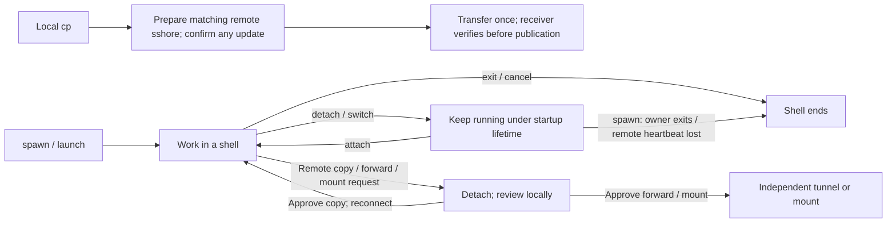

# sshore

[](https://github.com/jay-waves/sshore/actions/workflows/ci.yml)

Start a shell, leave it running, and return later. sshore combines local and
remote shell sessions with SSH file copies, TCP tunnels and SFTP mounts.

**Local:** Linux or Windows amd64/x86-64. **Remote:** Linux amd64/x86-64.
Requires system OpenSSH. ARM and macOS are not supported.
In the examples, `work` is a host or an alias from your SSH config.

## Install

Download a [release package](https://github.com/jay-waves/sshore/releases), or run:

**Linux**

```sh
curl -fsSL https://raw.githubusercontent.com/jay-waves/sshore/main/install.sh | sh
```

**Windows** — PowerShell 5.1 or 7:

```powershell
irm https://raw.githubusercontent.com/jay-waves/sshore/main/install.ps1 | iex
```

Installers verify checksums and print PATH instructions without requesting
administrator access. Close running Windows executables before upgrading.
Only the latest patch of each major/minor series remains downloadable.

Enable Tab completion in Bash with `source <(sshore completion bash)`.
Zsh, Fish and PowerShell are also supported; see `sshore completion --help` for
startup-file setup. Completion uses local/cached hints and never connects over SSH.

## TMUX — leave and resume work

Each session has one terminal. No tmux installation is needed.

```sh
sshore launch work build          # Start a persistent remote shell.
# Press Ctrl+B, then d to detach.
sshore attach work build          # Return to it later.
sshore cancel work build          # End it; unsaved work may be lost.
```

Choose the lifetime at startup; omit the host to work locally:

| Command | Lifetime |
| --- | --- |
| `sshore spawn` | Ends when the original parent shell exits. |
| `sshore spawn work` | Also ends if its background SSH heartbeat is lost. |
| `sshore launch [HOST]` | Survives client exit and network loss until you exit or cancel it. |

**Detach does not change lifetime.** A remote spawn keeps its heartbeat after
detach, and reattachment never changes its original owner. Use `launch` for work
that must survive disconnection. Daemon failure or host restart can end any shell.

Press **Ctrl+B**, then **d** to detach, **s** to switch sessions, or **?** for help.
Inside a remote shell, `sshore detach` also works. Both startup commands accept
`--detach` to start in the background. `attach` never takes over an attached shell.
Screens, scrollback and detached output are not saved.



## Status

```sh
sshore list                     # Local tasks and cached remote shells.
sshore list work                # Query remote tasks now.
sshore pstree                   # Spawn ownership and attachment sources.
sshore pstree work              # Relationships known to the remote account.
sshore list work --verbose      # Remote process trees and diagnostics.
sshore list --json              # Machine-readable inventory.
```

Use the stable IDs from `list` with `attach ID` or `cancel ID`.
In `--verbose`, LIFETIME is `parent` for local spawn, `heartbeat` for remote spawn, or
`persistent` for launch; it describes policy, not connection health.

CHECKED shows when shell states were confirmed; confirmed ended shells leave the default list.
Use `cancel` to clear confirmed ended remote history (see `sshore cancel --help`).
See `sshore list --help` for history and refresh behavior. `pstree` shows shell relationships, not a live OS
process tree; attaching from another shell does not transfer ownership. Peer
entries are read-only: manage them on their original computer. A running worker
does not prove its target service is healthy.

## SSH — connect your way

Use your usual SSH aliases, keys and authentication from `~/.ssh/config`.
**Put SSH options after `--`:**

```sh
sshore launch work build -- -J jump -p 2222
```

Supported shell targets are bash, sh, zsh and fish on Linux, and pwsh or cmd on
Windows. Terminal/shell pairings have different validation coverage; see
[shell and terminal validation](SSHORE.md#shell-and-terminal-validation).

## Copy — transfer files

From your **local shell**:

```sh
sshore cp report.zip work:/tmp/       # Upload.
sshore cp work:/tmp/report.zip ./    # Download.
```

From your **remote sshore shell**:

```sh
sshore cp origin: .                 # Request an upload from your computer.
sshore cp report.zip origin:        # Request a download to your computer.
```

Direct copies also prepare a matching remote sshore helper. Updating older software
requires confirmation and ends the listed shells and tasks; copying creates no
persistent shell. Upload verification runs on the receiver without downloading the file again.

`origin:` (or `:`) means the attached client computer. Remote requests detach
you; run `sshore review` locally, choose paths and submit to copy and reconnect.
Suggested paths still require your review. Ctrl-C during selection cancels.

Only regular files are supported; existing destinations are never overwritten.
Destination filesystems must support hard links. Failed batches keep completed
files. For pipes and other options, see `sshore cp --help`.

## Tunnel — forward a port

From your **local shell**, give the listener first, then the service:

```sh
sshore forward origin:8080 work:3000 --name web
sshore cancel forward/web
```

From a **remote sshore shell**, run `sshore forward origin: 3000` to request a
local listener for the remote service. This detaches you; run `sshore review`
locally and submit a port to start forwarding. The shell stays detached.

Listeners request IPv4 loopback; SSH server policy can override reverse binds.
Forwards end on disconnect by default. `--retries N` enables bounded retries for
local forwards, but cannot restore existing TCP connections. See
`sshore forward --help` for reverse forwarding and other options.

## Mount — open remote files locally

```sh
sshore mount work --name work       # Mount remote home; prints the local path.
sshore cancel mount/work            # Close local files before unmounting.
```

Mounts use SFTP and require FUSE on Linux or [WinFsp](https://winfsp.dev/) on
Windows. They are writable by default; use `--read-only` to prevent changes.
They run independently of shells and end if their own SSH connection drops.
From a remote sshore shell, use `sshore mount . origin:` and then `sshore review`
locally to select the mountpoint and approve access.

There is no offline editing, conflict detection or write retry. Interrupted
writes may leave partial files; caching can briefly delay remote changes.
By default, remote sshore supplies change notifications; `--no-watch` uses plain
SFTP without it. See `sshore mount --help` for details.

## Updates and troubleshooting

Client and remote versions must match exactly, including PATCH. Missing remote
software is prepared automatically. Updating an older installation requires
reviewing affected shells and typing `update`: **their tasks will end**.
Press Enter instead for a temporary recovery shell; existing shells stay running,
but sshore operations remain restricted until reconnecting. A newer remote version
requires updating your local client; it is never automatically downgraded.

- Stale screen after reattachment: press Ctrl-L or use the application's redraw key.
- SSH failure: try `sshore launch work -- -vvv -E ./ssh-debug.log`.
- Mount or forward failure: inspect `sshore list --verbose` and its log path.
- Existing copy destination: choose a new filename; overwriting is disabled.

Run `sshore COMMAND --help` for syntax, startup options, shortcuts and defaults.

## Project documents

- [SSHORE.md](SSHORE.md): architecture, validation, releases and planned work.
- [SECURITY.md](SECURITY.md): trust boundaries, update safeguards and cleanup limits.
- [GLOSSARY.md](GLOSSARY.md): terms and relationships.
- [AGENTS.md](AGENTS.md): contributor rules.

## Acknowledgements

Reference projects and inspiration:

- [dtach](https://github.com/crigler/dtach): lightweight shell detach and reattach.
- [trzsz](https://github.com/trzsz/trzsz): terminal-oriented file transfer workflows.
- The original `dssh.nu` prototype: the starting point for this project.

Built with [OpenSSH](https://www.openssh.com/),
[smux](https://github.com/xtaci/smux), [creack/pty](https://github.com/creack/pty),
[pkg/sftp](https://github.com/pkg/sftp), [go-fuse](https://github.com/hanwen/go-fuse),
[WinFsp](https://winfsp.dev/) / [go-winfsp](https://github.com/winfsp/go-winfsp),
[readline](https://github.com/chzyer/readline) and the Go ecosystem.
sshore does not implement the trzsz protocol.

[MIT license](LICENSE); third-party license notices are collected in
[THIRD_PARTY_LICENSES.txt](THIRD_PARTY_LICENSES.txt).
