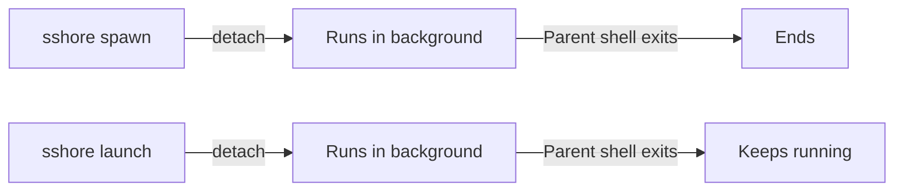
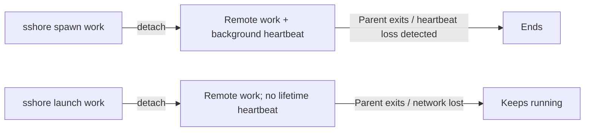

# sshore

[](https://github.com/jay-waves/sshore/actions/workflows/ci.yml)

SSH connections, SFTP mounts, detach and reattach (Mux), one-time file
copies, and TCP tunnels in one CLI.

**Local:** Linux or Windows amd64/x86-64. **Remote:** Linux amd64/x86-64.
Requires system OpenSSH. ARM and macOS are not supported.

## Install

Download a [release package](https://github.com/jay-waves/sshore/releases), or run:

**Linux**

```sh
curl -fsSL https://raw.githubusercontent.com/jay-waves/sshore/main/install.sh | sh
```

**Windows** — PowerShell 5.1 or 7:

```powershell
irm https://raw.githubusercontent.com/jay-waves/sshore/main/install.ps1 | iex
```

Installers verify checksums and print PATH instructions; they do not request
elevation. Defaults are `~/.local/bin` on Linux and `%LOCALAPPDATA%\sshore\bin`
on Windows. Close running Windows executables before upgrading.

Only the latest published patch in each major/minor series remains downloadable.
Older release assets are removed after a complete replacement is published; Git tags remain.

## SSH — connections and authentication

Use your normal SSH aliases, keys and authentication. Put recurring settings in
`~/.ssh/config`. **SSH options go after `--`; sshore options and operands go before it.**

```sh
sshore launch work build -- -J jump -p 2222
sshore launch work -- -i ~/.ssh/work
```

Run `sshore --help` or `sshore COMMAND --help` for syntax, defaults and supported
options. For paths beginning with `-` or containing a literal colon, use `./`
or an absolute path.

Remote shells and notification-enabled mounts prepare the exact matching release
automatically when missing. If the remote download fails, sshore downloads and
caches it locally, then transfers it over the same SSH connection. Updating an
older installation requires typing `update` after reviewing the shells/tasks it
will end. A newer remote version requires updating the local client.

## SFTP — remote directories as local mounts

Mount a remote directory for local applications:

```sh
sshore mount work --name work   # Remote home; prints local path and resource ID.
sshore list
sshore cancel mount/work        # Close local files before unmounting.
```

Mounts use **SFTP over SSH** and require FUSE on Linux or [WinFsp](https://winfsp.dev/)
on Windows. They are writable by default; `--read-only` prevents changes through
the mount. By default, a matching remote sshore release sends file-change notifications
over the same SSH connection; `--no-watch` uses plain SFTP without remote sshore.
Background mounts are independent of shells and terminals; a mount ends if its own SSH transport disconnects.
There is no offline editing, conflict detection or write retry; interrupted writes
may leave partial remote files. Directory and attribute caching can briefly delay
visibility of remote changes. See `sshore mount --help` for timeouts and diagnostics.

Use `sshore pstree` to view spawn ownership and attachment sources.
Cross-host relationships are cached observations; see `sshore pstree --help`.

## Shell × terminal compatibility

Supported shell targets: bash (GNU readline), sh, zsh and fish on Linux; pwsh with PSReadLine and cmd on Windows.
The table describes supported connection paths, **not a fully tested matrix**.
**L** = Linux local or remote, **R** = remote Linux over SSH, **W** = Windows local;
**—** = outside scope. Every terminal/shell pairing below still needs dedicated
interactive validation. Terminal columns refer only to Linux/Windows amd64 builds.

| Shell | Ghostty (Linux) | Alacritty (Linux / Windows) | Windows Terminal | WezTerm (Linux / Windows) | xterm (Linux) | GNOME Terminal (Linux) | Existing shell evidence |
| --- | --- | --- | --- | --- | --- | --- | --- |
| bash | L | L / R | R | L / R | L | L | Linux startup-file and reconnect regressions |
| sh | L | L / R | R | L / R | L | L | Linux PTY/lifecycle tests; actual sh implementation matters |
| zsh | L | L / R | R | L / R | L | L | Linux reconnect editor and job-control regressions |
| fish | L | L / R | R | L / R | L | L | Linux reconnect editor and job-control regressions |
| pwsh | — | — / W | W | — / W | — | — | Static ConPTY/input review; native Windows checks pending |
| cmd | — | — / W | W | — / W | — | — | ConPTY lifecycle test coverage; pairing checks pending |

Alacritty and Windows Terminal have positive user reports, without a recorded
per-shell matrix. Ghostty has a source-level review; its headless interactive
probe did not complete. Enhanced keyboard encodings may bypass Ctrl+B shortcuts.
Terminal applications may also need terminfo matching the client TERM on the
remote host. See [terminal design and limits](SSHORE.md#terminal-and-mux-design-scope).

## TMUX

Leave a shell running, work elsewhere, then attach again. Each session has one
terminal; sshore provides its own detach/reattach support without requiring tmux.

Choose the lifetime when you start a shell:

| Command | Use it for | When it ends |
| --- | --- | --- |
| `sshore spawn` | Temporary local work tied to your current shell. | The original parent shell exits. |
| `sshore spawn HOST` | Temporary remote work that should not be left running indefinitely after you leave. | The original parent shell exits, or the background SSH heartbeat is lost. |
| `sshore launch [HOST]` | Independent work that must survive closing your terminal or losing the network. | You exit or cancel it; client disconnection does not end it. |

**Detach switches work; it does not change lifetime.** A remote spawn keeps its
heartbeat running after detach. Attaching from somewhere else does not transfer
its ownership. Heartbeat loss is detected after a timeout, so a network outage
can end a remote spawn; use `launch` when that work must survive disconnection.
All shells can also end if their daemon fails or the host restarts.

```sh
sshore spawn                      # Temporary local shell.
sshore spawn work                 # Temporary remote shell on work.
sshore launch work build          # Persistent remote shell named build.
# Ctrl+B then d: detach and return to the calling shell.
sshore list work                  # Find the shell and its lifetime policy.
sshore attach work build          # Continue working in build.
sshore cancel work build          # End it immediately; unsaved work may be lost.
```

Both startup commands accept `--detach` to start in the background. `attach`
only resumes existing shells and never takes over an attached shell.
`list` shows stable numeric IDs; use `attach ID` or `cancel ID` for convenience.
`list` alone uses local records; `list HOST` queries the remote account. Cached
state is labelled. `pstree` shows spawn ownership and attachment sources;
`list --verbose` shows remote process trees.

Press Ctrl+B then d to detach, s to choose another session, or ? for all keys.
In a remote shell, `sshore detach` also works. Switching leaves the previous
shell running under its original lifetime policy; remote switching may require
SSH authentication again. Screens, scrollback and detached output are not saved.

**Local — close the original parent shell:**



**Remote — close the original parent shell or lose the network:**



For startup options, shortcuts and task management, see `sshore spawn --help`,
`sshore launch --help` and `sshore --help`. See the
[security model](SECURITY.md) for cleanup guarantees and limits.

## Copy — files through SSH

From your **local shell**, copy directly:

```sh
sshore cp report.zip work:/tmp/
sshore cp work:/tmp/report.zip ./downloads/
```

From your **remote sshore shell**, request a copy:

```sh
sshore cp origin: .              # Choose a local source, copy it here.
sshore cp report.zip :          # Choose a local destination.
sshore cp report.zip origin:./downloads/
```

Local copies support pipes: `sshore cp work:/tmp/report.txt - | less` reads a
remote file; `generate-report | sshore cp - work:/tmp/report.txt` writes a new
remote file. Output streams cannot be rolled back if a transfer fails.

`origin:` and `:` refer to the attached client computer. A filled `origin:PATH`
suggests a path for local review. Requests detach you; run `sshore review` locally,
choose or accept paths, and submit to copy and reconnect. `review --stay` remains
local. `cancel review/NAME` discards a request.

Submitting all paths approves the batch; there is no extra `yes`. Ctrl-C during
selection starts no transfer. Requests expire after ten minutes. Only regular
files are supported, destinations are never overwritten, and destination
filesystems must support hard links. Failed batches retain completed files.

## Tunnel — TCP port forwarding

From your **local shell**, specify the listener and then the service:

```sh
sshore forward origin:8080 work:3000 --name web
sshore forward work:3000 origin:8080
sshore cancel forward/web
```

From your **remote sshore shell**:

```sh
sshore forward origin: 3000      # Choose a local listener for this server service.
sshore forward 3000 :           # Choose a local service for this server listener.
sshore forward 3000 origin:8080  # Suggest a local service port for review.
```

The request detaches you. Run `sshore review` locally, enter a port or accept
the displayed suggestion to start forwarding. There is no extra `yes`.
Ctrl-C cancels. The source shell stays detached. Listeners request IPv4 loopback;
server SSH policy can override reverse binds.

Forwards end on disconnect by default; local `--retries N` opts into bounded retries, which do not
restore existing TCP connections. Resources do not restart after local shutdown.
Native SSH `-L/-R/-D` remain separate connection-level options; see command help.

## Status

```sh
sshore list                     # Local mounts, forwards and pending requests.
sshore list work                # Also query remote shells and peer inventory.
sshore list --verbose           # Transport state, last errors and log paths.
sshore list --json              # Machine-readable inventory.
```

A running worker does not prove that its target service is healthy. `peer/` entries
are read-only snapshots; manage them on their original computer.

## Updates and troubleshooting

Client and remote releases must match exactly, including PATCH. Missing remote
software may be installed automatically. Updating an older installation requires
typing `update` after reviewing affected shells: **their tasks will end**.
Press Enter instead for a temporary recovery shell; existing shells stay running,
but sshore operations are restricted until reconnecting. Newer remote versions
are never downgraded. See the [security model](SECURITY.md#remote-setup-and-updates).

- Stale screen after reattachment: use Ctrl-L or the application's redraw command.
- SSH failure: try `sshore launch work -- -vvv -E ./ssh-debug.log`.
- Mount or forward failure: inspect `sshore list --verbose` and its log path.
- Existing transfer destination: choose a new filename; overwriting is disabled.

## TODO

- [ ] Add `pull` (remote → local) and `push` (local → remote) for incremental
  directory synchronization. Files remain on disk after synchronization stops.
  Proposed behavior: one-shot by default; `--watch` runs a background task managed
  through `list` and `cancel`; deletion propagation requires `--delete`, and
  independently modified destination files are reported as conflicts. Not yet implemented.

## Project documents

- [SSHORE.md](SSHORE.md): development, architecture, validation and releases.
- [SECURITY.md](SECURITY.md): trust boundaries, safeguards and remaining risks.
- [GLOSSARY.md](GLOSSARY.md): terms and relationships.
- [AGENTS.md](AGENTS.md): contributor and agent rules.

## Acknowledgements

Reference projects and inspiration:

- [dtach](https://github.com/crigler/dtach): lightweight shell detach and reattach.
- [trzsz](https://github.com/trzsz/trzsz): terminal-oriented file transfer workflows.
- The original `dssh.nu` prototype: the starting point for this project.

Built with [OpenSSH](https://www.openssh.com/),
[smux](https://github.com/xtaci/smux), [creack/pty](https://github.com/creack/pty),
[pkg/sftp](https://github.com/pkg/sftp), [go-fuse](https://github.com/hanwen/go-fuse),
[WinFsp](https://winfsp.dev/) / [go-winfsp](https://github.com/winfsp/go-winfsp),
[readline](https://github.com/chzyer/readline) and the Go ecosystem.
sshore does not implement the trzsz protocol.

[MIT license](LICENSE); third-party license notices are collected in
[THIRD_PARTY_LICENSES.txt](THIRD_PARTY_LICENSES.txt).
