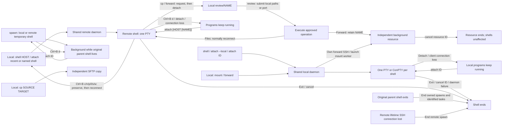

# sshore

[](https://github.com/jay-waves/sshore/actions/workflows/ci.yml)

SSH connections, SFTP mounts, detach and reattach (Mux), one-time file
copies, and TCP tunnels in one CLI.

**Local:** Linux or Windows amd64/x86-64. **Remote:** Linux amd64/x86-64.
Requires system OpenSSH. ARM and macOS are not supported.

## Install

Download a [release package](https://github.com/jay-waves/sshore/releases), or run:

**Linux**

```sh
curl -fsSL https://raw.githubusercontent.com/jay-waves/sshore/main/install.sh | sh
```

**Windows** — PowerShell 5.1 or 7:

```powershell
irm https://raw.githubusercontent.com/jay-waves/sshore/main/install.ps1 | iex
```

Installers verify checksums and print PATH instructions; they do not request
elevation. Defaults are `~/.local/bin` on Linux and `%LOCALAPPDATA%\sshore\bin`
on Windows. Close running Windows executables before upgrading.

Only the latest published patch in each major/minor series remains downloadable.
Older release assets are removed after a complete replacement is published; Git tags remain.

## SSH — connections and authentication

Use your normal SSH aliases, keys and authentication. Put recurring settings in
`~/.ssh/config`. **SSH options go after `--`; sshore options and operands go before it.**

```sh
sshore shell work build -- -J jump -p 2222
sshore shell work -- -i ~/.ssh/work
```

Run `sshore --help` or `sshore COMMAND --help` for syntax, defaults and supported
options. For paths beginning with `-` or containing a literal colon, use `./`
or an absolute path.

## SFTP — remote directories as local mounts

Mount a remote directory for local applications:

```sh
sshore mount work               # Remote home; prints local path and resource ID.
sshore list
sshore cancel mount/work        # Close local files before unmounting.
```

Mounts use **SFTP over SSH** and require FUSE on Linux or [WinFsp](https://winfsp.dev/)
on Windows. They are writable by default; `--read-only` prevents changes through
the mount. By default, a matching remote sshore release sends file-change notifications
over the same SSH connection; `--no-watch` uses plain SFTP without remote sshore.
Background mounts are independent of shells and terminals; a mount ends if its own SSH transport disconnects.
There is no offline editing, conflict detection or write retry; interrupted writes
may leave partial remote files. Directory and attribute caching can briefly delay
visibility of remote changes. See `sshore mount --help` for timeouts and diagnostics.

## Mux — detach and reattach

Run `sshore shell` for a local shell, or `sshore shell HOST` for a remote shell.
Local shells share a user-level daemon, use Linux PTY or Windows ConPTY, and need no SSH server. The same daemon owns forward SSH connections and launches independent mount workers.
Detach while programs keep running, then reattach
to continue. Press Ctrl+B then d, or run `sshore detach` in the
remote shell. Ctrl+B then c creates a session; n/p cycles, l returns to the
previous session, and s opens the session chooser. Ctrl+B then ? shows keys;
see `sshore --help`. Switching preserves the previous session; remote switching reconnects SSH;
authentication may be requested again.

```sh
sshore shell --name dev           # Local shell in the current directory.
sshore list                    # Stable numeric IDs, ordered across tasks.
sshore attach 3                # Resume the shell with ID 3.
sshore shell work                 # Remote shell; prints its automatic name.
sshore shell work build           # Or choose a name.
# Press Ctrl+B then d to detach and keep programs running.
sshore attach work build        # Resume a specific detached shell.
sshore attach work              # Resume the most recently used shell on work.
sshore attach                   # Reuse the most recent host and shell.
sshore list work                # Show resources and remote shells.
sshore rename work build dev    # Rename without restarting tasks.
sshore cancel work dev          # Immediately end the shell and its tasks.
```

Task IDs remain stable through rename and reconnect, increase monotonically and
are never reused. Gaps are normal. Use `attach ID`, `cancel ID`, `rename ID NEW`
or `review ID`; cached remote identities are revalidated before action.

`shell` only creates; `attach` only resumes. With no saved connection for a host,
omitting the shell name selects a detached shell. Recent targets retain SSH
connection options; explicit options override them. An attached shell cannot
be taken over, and an ended recent shell is not recreated.

`shell` sessions survive detach, client exit and connection loss; `exit` inside the shell
or `cancel ID` ends them. Use `shell --detach` to create without entering.
In a remote shell, `sshore detach` also works. Screens, scrollback and detached
output are not saved. A daemon failure can end its shells.

Use `sshore spawn [HOST]` for a temporary shell bound to the launching parent
shell. Detach returns to that parent; `attach ID` returns to the spawn. Closing
the original parent shell ends the spawn and its identified tasks, even after
reattachment elsewhere. Remote spawns also end if their lifetime SSH connection
is lost (after disconnect detection). `list` shows `spawn/NAME` or `shell/NAME`
in the existing task column. See `sshore spawn --help`.

`cancel HOST --all` lists and confirms all tasks for that machine; `cancel --all`
clears local tasks. Single-task cancellation is immediate; unsaved work may be
lost. Remote shell/attach connections show other tasks using the same table as
`list`, including mounts, forwards and pending requests.



`sshore list` shows local records ordered by stable task ID and does not contact remote
hosts. Use `sshore list HOST` to query that account, or add `--verbose` for process
trees. Cached shell state is labelled with its last confirmation time.

Shells, forwards, mounts and pending reviews automatically share a pool of Pokemon
names on each computer. Use a numeric task ID or a typed name, such as `review/eevee`
or `forward/eevee`; an approved forward keeps its review name.

## Copy — files through SSH

From your **local shell**, copy directly:

```sh
sshore cp report.zip work:/tmp/
sshore cp work:/tmp/report.zip ./downloads/
```

From your **remote sshore shell**, request a copy:

```sh
sshore cp origin: .              # Choose a local source, copy it here.
sshore cp report.zip :          # Choose a local destination.
sshore cp report.zip origin:./downloads/
```

Local copies support pipes: `sshore cp work:/tmp/report.txt - | less` reads a
remote file; `generate-report | sshore cp - work:/tmp/report.txt` writes a new
remote file. Output streams cannot be rolled back if a transfer fails.

`origin:` and `:` refer to the attached client computer. A filled `origin:PATH`
suggests a path for local review. Requests detach you; run `sshore review` locally,
choose or accept paths, and submit to copy and reconnect. `review --stay` remains
local. `cancel review/NAME` discards a request.

Submitting all paths approves the batch; there is no extra `yes`. Ctrl-C during
selection starts no transfer. Requests expire after ten minutes. Only regular
files are supported, destinations are never overwritten, and destination
filesystems must support hard links. Failed batches retain completed files.

## Tunnel — TCP port forwarding

From your **local shell**, specify the listener and then the service:

```sh
sshore forward origin:8080 work:3000 --name web
sshore forward work:3000 origin:8080
sshore cancel forward/web
```

From your **remote sshore shell**:

```sh
sshore forward origin: 3000      # Choose a local listener for this server service.
sshore forward 3000 :           # Choose a local service for this server listener.
sshore forward 3000 origin:8080  # Suggest a local service port for review.
```

The request detaches you. Run `sshore review` locally, enter a port or accept
the displayed suggestion to start forwarding. There is no extra `yes`.
Ctrl-C cancels. The source shell stays detached. Listeners request IPv4 loopback;
server SSH policy can override reverse binds.

Forwards end on disconnect by default; local `--retries N` opts into bounded retries, which do not
restore existing TCP connections. Resources do not restart after local shutdown.
Native SSH `-L/-R/-D` remain separate connection-level options; see command help.

## Status

```sh
sshore list                     # Local mounts, forwards and pending requests.
sshore list work                # Also query remote shells and peer inventory.
sshore list --verbose           # Transport state, last errors and log paths.
sshore list --json              # Machine-readable inventory.
```

A running worker does not prove that its target service is healthy. `peer/` entries
are read-only snapshots; manage them on their original computer.

## Updates and troubleshooting

Client and remote releases must match exactly, including PATCH. Missing remote
software may be installed automatically. Updating an older installation requires
typing `update` after reviewing affected shells: **their tasks will end**.
Press Enter instead for a temporary recovery shell; existing shells stay running,
but sshore operations are restricted until reconnecting. Newer remote versions
are never downgraded. See the [security model](SECURITY.md#remote-setup-and-updates).

- Stale screen after reattachment: use Ctrl-L or the application's redraw command.
- SSH failure: try `sshore shell work -- -vvv -E ./ssh-debug.log`.
- Mount or forward failure: inspect `sshore list --verbose` and its log path.
- Existing transfer destination: choose a new filename; overwriting is disabled.

## Project documents

- [SSHORE.md](SSHORE.md): development, architecture, validation and releases.
- [SECURITY.md](SECURITY.md): trust boundaries, safeguards and remaining risks.
- [GLOSSARY.md](GLOSSARY.md): terms and relationships.
- [AGENTS.md](AGENTS.md): contributor and agent rules.

## Acknowledgements

Reference projects and inspiration:

- [dtach](https://github.com/crigler/dtach): lightweight shell detach and reattach.
- [trzsz](https://github.com/trzsz/trzsz): terminal-oriented file transfer workflows.
- The original `dssh.nu` prototype: the starting point for this project.

Built with [OpenSSH](https://www.openssh.com/),
[smux](https://github.com/xtaci/smux), [creack/pty](https://github.com/creack/pty),
[pkg/sftp](https://github.com/pkg/sftp), [go-fuse](https://github.com/hanwen/go-fuse),
[WinFsp](https://winfsp.dev/) / [go-winfsp](https://github.com/winfsp/go-winfsp),
[readline](https://github.com/chzyer/readline) and the Go ecosystem.
sshore does not implement the trzsz protocol.

[MIT license](LICENSE); third-party license notices are collected in
[THIRD_PARTY_LICENSES.txt](THIRD_PARTY_LICENSES.txt).
