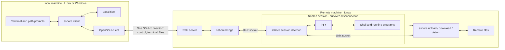

# sshore

[](https://github.com/jay-waves/sshore/actions/workflows/ci.yml)

A small SSH command-line tool: disconnect while your remote shell keeps running, then reconnect to the same process. Supports multiple named sessions, with one attached client per session.

The server runs on Linux; clients run on Linux and Windows. Shell access and file transfers share one SSH connection, so transferring files does not ask for your SSH password again. Authentication and connection settings come from system OpenSSH.

## Architecture



Each named session keeps its shell running independently of the SSH connection. Use `-s NAME` with the same host to resume; only one client can attach at a time.

## Install

Prebuilt binaries do not require Go. After a successful CI run, download Linux or Windows packages for amd64 or arm64 from the [Actions artifacts](https://github.com/jay-waves/sshore/actions). Download archives and SHA-256 checksums from [Releases](https://github.com/jay-waves/sshore/releases). Releases are rolling updates within each version line; verify archives against `SHA256SUMS` and retry if a download overlaps an update.

Building from source requires Go 1.25+. The local machine needs an OpenSSH client (`ssh` or `ssh.exe`), and the remote machine needs a working SSH server.

```sh
git clone https://github.com/jay-waves/sshore.git
cd sshore
go build -o dist/sshore .

# Cross-compile the Windows client on Linux.
CGO_ENABLED=0 GOOS=windows GOARCH=amd64 go build -buildvcs=false -o dist/sshore.exe .
```

Install the Linux binary on the remote PATH, for example as `~/.local/bin/sshore`, and install the appropriate binary locally. Use the same version on both ends; connections check the protocol version. No root access or additional listening network port is required.

Version 0.2 uses a new multiplexing protocol that is incompatible with 0.1. Before upgrading, attach to any running 0.1 sessions with the old client and exit their shells, then replace both binaries. Running session processes cannot upgrade their protocol in place.

```sh
# Install on the Linux server.
install -Dm755 dist/sshore "$HOME/.local/bin/sshore"
```

A noninteractive SSH connection may not include `~/.local/bin` in PATH. Specify an absolute remote path if needed:

```sh
sshore myserver --server /home/alice/.local/bin/sshore
```

Run the Windows client in a modern console with VT support, such as Windows Terminal. The Windows binary is a client; session and file commands run inside the connected Linux shell.

## Connect and manage sessions

```sh
sshore user@host                 # Create a new automatically named session.
sshore myserver -s build         # Create or attach to the build session.
sshore myserver list             # List sessions, shell PIDs, and attachment status.
sshore myserver -J jump -p 2222   # Pass SSH connection options.
sshore myserver --download-dir ./downloads  # Save downloads automatically.
```

sshore uses system OpenSSH configuration, host keys, and authentication settings. Supported SSH options are `-p`, `-i`, `-J`, `-F`, `-l`, `-o`, `-v`, `-4`, and `-6`. Put complex settings in `~/.ssh/config`. Not every OpenSSH option is forwarded. If a host alias conflicts with a built-in command, configure another SSH alias for that host.

Session names contain 1-48 ASCII letters, digits, underscores, or hyphens, starting with a letter or digit. An attached session rejects a second client; clients cannot take over a connection or share input.

Without `-s`, every connection creates a new session using an available Pokemon English name (for example `pikachu` or `eevee`), without a suffix. Attached and detached sessions both reserve their names. If all automatic names are occupied, the command reports an error; exit an existing session or use `-s NAME` to choose another name. The connection message shows its name. Use `sshore myserver list` to find existing sessions and `sshore myserver -s NAME` to reconnect.

Inside the remote shell, run `sshore detach` to leave the session running, or `exit` to end it. Reconnect with the same command, for example `sshore myserver -s build`.

## Transfer files

Run these commands inside the remote shell:

```sh
sshore upload                   # Choose a local file to upload to the current directory.
sshore upload /tmp/uploads       # Upload to a specific remote directory.
sshore download ./report.zip     # Choose a local destination for the download.
sshore download a.zip b.log c.png # Download a batch, with up to two concurrent transfers.
```

Local keyboard controls:

- `Ctrl-]` detaches even when a remote foreground program is running.
- During a path prompt, `Ctrl-C` cancels only the transfer associated with that prompt.
- With active transfers but no path prompt, `Ctrl-C` cancels the most recently added active transfer. Other transfers continue. Task IDs appear in prompts and progress messages.
- With no file transfers, `Ctrl-C` goes to the remote program. Detaching or losing the connection cancels all transfers on that connection.

File selection uses command-line path input. UTF-8 paths, spaces, surrounding quotes, and `~/` are supported. Command substitution and wildcard expansion are not performed. For downloads, press Enter to accept the default filename in the current local directory, or enter a directory or full destination path.

A session supports simultaneous uploads and downloads, with at most two active tasks, including tasks waiting for a local path. For example, start two downloads remotely:

```sh
sshore download ./a.zip &
sshore download ./b.zip &
wait
```

The client prompts for each destination in turn; confirmed transfers continue while another prompt is open. Starting a third independent active task returns a concurrency-limit error. `sshore download FILE...` processes the batch with up to two files at a time. Failed files do not cancel the remaining files, and the command reports an aggregate exit status. A batch uses the same two transfer slots and creates no additional SSH connections.

## Command reference

Common options:

| Option | Purpose |
| --- | --- |
| `-s, --session NAME` | Create or resume this session; omitted: create a new Pokemon-named session |
| `--server PATH` | Remote sshore executable; defaults to a PATH lookup |
| `--download-dir DIRECTORY` | Existing local directory for automatic downloads without individual path prompts; never overwrites files |
| `-q, --quiet` | Hide periodic progress while retaining prompts, completion messages, and errors |
| `--no-escape` | Forward Ctrl-] to the remote application; use `sshore detach` to disconnect |
| `-h, --help` | Show help; accepted before or after connection arguments |
| `-V, --version` | Show the version |

Use `sshore help download` or `sshore download --help` for command help. Put `--` before paths that begin with a hyphen, for example `sshore download -- -report.txt`. Invalid arguments return exit code `2`; other failures return a nonzero code. A normal remote shell exit preserves its exit code.

Local messages use your terminal’s ANSI 16-color palette: cyan for information and progress, green for success, yellow for cancellation and warnings, and red for errors. Set `NO_COLOR=1` to disable colors. Redirected output and `TERM=dumb` remain plain text.

## Behavior and limitations

- Sessions preserve the shell, working directory, environment variables, and running programs. Terminal screens and scrollback are not saved or restored. Press `Ctrl-L` after reconnecting if a redraw is needed.
- Output produced while detached is discarded. There is no automatic reconnection; reconnect with `sshore HOST -s NAME`.
- The session ends when its shell exits. Reboots, process termination, or system login-session cleanup policies can also end it.
- Transfers can run in both directions; canceling one does not close the terminal or other transfers. Only ordinary files are supported, without directories, symbolic links, resumable transfers, drag and drop, or nested SSH. File transfers do not interoperate with SFTP or trzsz.
- Transfers verify file size and SHA-256 and never overwrite existing files. Cancellation and disconnection remove incomplete files; a forcibly killed receiver or system crash may leave `.sshore-*.part` files.
- Publishing requires hard-link support on the destination filesystem, such as common Linux filesystems or Windows NTFS. Unsupported filesystems produce an error, without falling back to an operation that might overwrite a file. Permissions, timestamps, and other metadata are not copied. Received files default to `0600` on Linux and inherit the destination directory's ACL on Windows.
- During file prompts, keyboard input is not forwarded remotely. Remote output is temporarily buffered; excess output is omitted with a notice. Path prompts provide basic line editing, without full shell completion.
- SSH agent and X11 forwarding environments come from the connection that created the session and are not refreshed on reconnect. Forwarding is not guaranteed to remain usable after reconnecting.
- Login scripts that print to stdout for noninteractive SSH connections interfere with the protocol handshake. Restrict such output to interactive shells.

## Runtime directory

sshore prefers `$XDG_RUNTIME_DIR/sshore`, falling back to `/tmp/sshore-UID`. The directory must belong to the current user with mode `0700`. Override it with `SSHORE_RUNTIME_DIR`, using a short absolute path under an existing parent directory. Unix socket paths have a limited length.

If a connection fails, check the session's `.log` file in the runtime directory for background errors. Logs may remain after a session exits; use `sshore HOST list` to check active sessions.

## Acknowledgments and references

Thanks to the authors and maintainers of these projects:

- [dtach](https://github.com/crigler/dtach): a reference for keeping a terminal process alive independently of its attached client, with a deliberately small detach/attach model.
- The original `dssh.nu` prototype supplied for this project: the starting point for combining SSH with persistent named sessions.
- [trzsz](https://github.com/trzsz/trzsz) and [trzsz-go](https://github.com/trzsz/trzsz-go): inspiration for initiating file transfers from a remote shell with local interaction. sshore implements its own protocol and does not use or interoperate with trzsz.
- [OpenSSH](https://www.openssh.com/): the external SSH client and server providing authentication, encryption, and connection configuration.
- [smux](https://github.com/xtaci/smux): the Go dependency providing stream multiplexing and flow control over the SSH transport.
- [creack/pty](https://github.com/creack/pty): the Go dependency providing Linux PTY creation and resizing.

References and inspiration are distinct from runtime dependencies. Dependency versions are recorded in `go.mod`; each upstream project retains its own license.

## License

[MIT](LICENSE).
