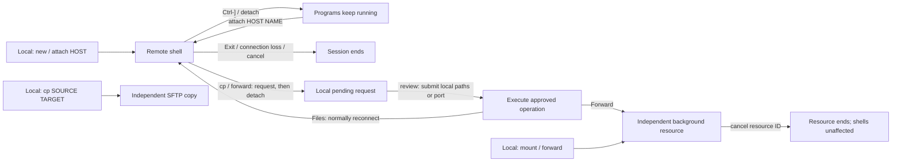

# sshore

[](https://github.com/jay-waves/sshore/actions/workflows/ci.yml)

SSH connections, SFTP mounts, detach and reattach (Mux), one-time file
copies, and TCP tunnels in one CLI.

**Local:** Linux or Windows amd64/x86-64. **Remote:** Linux amd64/x86-64.
Requires system OpenSSH. ARM and macOS are not supported.

## Install

Download a [release package](https://github.com/jay-waves/sshore/releases), or run:

**Linux**

```sh
curl -fsSL https://raw.githubusercontent.com/jay-waves/sshore/main/install.sh | sh
```

**Windows** — PowerShell 5.1 or 7:

```powershell
irm https://raw.githubusercontent.com/jay-waves/sshore/main/install.ps1 | iex
```

Installers verify checksums and print PATH instructions; they do not request
elevation. Defaults are `~/.local/bin` on Linux and `%LOCALAPPDATA%\sshore\bin`
on Windows. Close running Windows executables before upgrading.

## SSH — connections and authentication

Use your normal SSH aliases, keys and authentication. Put recurring settings in
`~/.ssh/config`. **SSH options go after `--`; sshore options and operands go before it.**

```sh
sshore new work build -- -J jump -p 2222
sshore new work -- -i ~/.ssh/work
```

Run `sshore --help` or `sshore COMMAND --help` for syntax, defaults and supported
options. For paths beginning with `-` or containing a literal colon, use `./`
or an absolute path.

## SFTP — remote directories as local mounts

Mount a remote directory for local applications:

```sh
sshore mount work               # Remote home; prints local path and resource ID.
sshore list
sshore cancel mount/work        # Close local files before unmounting.
```

Mounts use **SFTP over SSH** and require FUSE on Linux or [WinFsp](https://winfsp.dev/)
on Windows. They are writable by default; `--read-only` prevents changes through
the mount. Mounts are independent of shell sessions and end on disconnect.
There is no offline editing, conflict detection or write retry; interrupted writes
may leave partial remote files. See `sshore mount --help` for timeouts and options.

## Mux — detach and reattach

Detach from your remote shell while its programs keep running, then reattach
to continue. Press Ctrl-] or run `sshore detach` in the remote shell.

```sh
sshore new work                 # Create a session; prints its automatic name.
sshore new work build           # Or choose a name.
# Press Ctrl-] to detach and keep programs running.
sshore attach work build        # Resume a detached session.
sshore list work                # Show resources and remote sessions.
sshore rename work build dev    # Rename without restarting tasks.
sshore cancel work dev          # Immediately end the session and its tasks.
```

`new` only creates; `attach` only resumes. Omit the name in `attach` to select a
detached session. An attached session cannot be taken over.

**Only explicit detach preserves the session.** In the remote shell,
`sshore detach` also works. `exit`, closing the local terminal or detected
connection loss ends the session. Screens, scrollback and detached output are
not saved. `cancel HOST NAME` has no confirmation; unsaved work may be lost.



## Copy — files through SSH

From your **local shell**, copy directly:

```sh
sshore cp report.zip work:/tmp/
sshore cp work:/tmp/report.zip ./downloads/
```

From your **remote sshore shell**, request a copy:

```sh
sshore cp origin: .              # Choose a local source, copy it here.
sshore cp report.zip :          # Choose a local destination.
sshore cp report.zip origin:./downloads/
```

Local copies support pipes: `sshore cp work:/tmp/report.txt - | less` reads a
remote file; `generate-report | sshore cp - work:/tmp/report.txt` writes a new
remote file. Output streams cannot be rolled back if a transfer fails.

`origin:` and `:` refer to the attached client computer. A filled `origin:PATH`
suggests a path for local review. Requests detach you; run `sshore review` locally,
choose or accept paths, and submit to copy and reconnect. `review --stay` remains
local. `cancel approval/ID` discards a request.

Submitting all paths approves the batch; there is no extra `yes`. Ctrl-C during
selection starts no transfer. Requests expire after ten minutes. Only regular
files are supported, destinations are never overwritten, and destination
filesystems must support hard links. Failed batches retain completed files.

## Tunnel — TCP port forwarding

From your **local shell**, specify the listener and then the service:

```sh
sshore forward origin:8080 work:3000 --name web
sshore forward work:3000 origin:8080
sshore cancel forward/web
```

From your **remote sshore shell**:

```sh
sshore forward origin: 3000      # Choose a local listener for this server service.
sshore forward 3000 :           # Choose a local service for this server listener.
sshore forward 3000 origin:8080  # Suggest a local service port for review.
```

The request detaches you. Run `sshore review` locally, enter a port or accept
the displayed suggestion to start forwarding. There is no extra `yes`.
Ctrl-C cancels. The source shell stays detached. Listeners request IPv4 loopback;
server SSH policy can override reverse binds.

Forwards end on disconnect by default; local `--retries N` opts into bounded retries, which do not
restore existing TCP connections. Resources do not restart after local shutdown.
Native SSH `-L/-R/-D` remain separate connection-level options; see command help.

## Status

```sh
sshore list                     # Local mounts, forwards and pending requests.
sshore list work                # Also query remote sessions and peer inventory.
sshore list --details           # Transport state, last errors and log paths.
sshore list --json              # Machine-readable inventory.
```

A running worker does not prove that its target service is healthy. `peer/` entries
are read-only snapshots; manage them on their original computer.

## Updates and troubleshooting

Client and remote releases must match exactly, including PATCH. Missing remote
software may be installed automatically. Updating an older installation requires
typing `update` after reviewing affected sessions: **their tasks will end**.
Press Enter instead for a temporary recovery shell; existing sessions stay running,
but sshore operations are restricted until reconnecting. Newer remote versions
are never downgraded. See the [security model](SECURITY.md#remote-setup-and-updates).

- Stale screen after reattachment: use Ctrl-L or the application's redraw command.
- SSH failure: try `sshore new work -- -vvv -E ./ssh-debug.log`.
- Mount or forward failure: inspect `sshore list --details` and its log path.
- Existing transfer destination: choose a new filename; overwriting is disabled.

## Project documents

- [SSHORE.md](SSHORE.md): development, architecture, validation and releases.
- [SECURITY.md](SECURITY.md): trust boundaries, safeguards and remaining risks.
- [GLOSSARY.md](GLOSSARY.md): terms and relationships.
- [AGENTS.md](AGENTS.md): contributor and agent rules.

## Acknowledgements

Reference projects and inspiration:

- [dtach](https://github.com/crigler/dtach): lightweight shell detach and reattach.
- [trzsz](https://github.com/trzsz/trzsz): terminal-oriented file transfer workflows.
- The original `dssh.nu` prototype: the starting point for this project.

Built with [OpenSSH](https://www.openssh.com/),
[smux](https://github.com/xtaci/smux), [creack/pty](https://github.com/creack/pty),
[pkg/sftp](https://github.com/pkg/sftp), [go-fuse](https://github.com/hanwen/go-fuse),
[WinFsp](https://winfsp.dev/) / [go-winfsp](https://github.com/winfsp/go-winfsp),
[readline](https://github.com/chzyer/readline) and the Go ecosystem.
sshore does not implement the trzsz protocol.

[MIT license](LICENSE); third-party license notices are collected in
[THIRD_PARTY_LICENSES.txt](THIRD_PARTY_LICENSES.txt).
