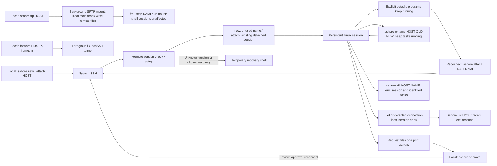

# sshore

[](https://github.com/jay-waves/sshore/actions/workflows/ci.yml)

Disconnect from SSH without stopping your remote shell. Reconnect to pick up where you left off.

**Local:** Linux or Windows, amd64/x86-64. **Remote:** Linux amd64/x86-64. Requires OpenSSH; ARM and macOS are not supported.

## Quick start

```sh
sshore new myserver             # New session with an automatic Pokemon name.
# Press Ctrl-] to detach and keep programs running.
sshore attach myserver pikachu  # Resume the name printed when connecting.
sshore new myserver build       # Create a separate named session.
sshore list myserver            # List session ages, states and process trees.
sshore kill myserver build      # End this session and its tasks immediately.
sshore new --help               # Command-specific help.
```

Uses your normal SSH aliases, keys and authentication. **`new` only creates; `attach` only resumes.** An existing name is an error for `new`; a missing name is an error for `attach`. Omit the name in `attach` to resume the only detached session or choose from several. Choose by `#number` or name; `/text` filters the list and Enter cancels. See `sshore attach --help`. An attached session cannot be taken over.

Inside the remote shell, `sshore detach` also detaches; `exit` ends the session. Only explicit detach preserves a session: closing the local terminal or losing the connection ends it once detected, as with SSH. After detach, copy the printed `sshore attach` command to reconnect.

The old `sshore HOST`, `sshore connect HOST`, `sshore HOST list` and `-s`/`--session` forms are no longer accepted. Use the explicit commands above.

Automatic names come from 24 familiar Pokemon, starting with `pikachu`, `eevee`, `bulbasaur`, `charmander`, `squirtle`, `snorlax`, `psyduck` and `gengar`. Detached sessions keep their names. If all 24 are in use, choose any custom name with `sshore new HOST NAME`.



`sshore list HOST` shows session age, foreground programs, shortened working directories, process trees and recent exit reasons:

```text
charmander [attached] · started 2h ago
  codex · ~/src/project
`-- 2602271 bash
    `-- 2602398 codex [foreground]

pikachu [detached] · started 2d ago
  bash · ~
`-- 2451576 bash [foreground]
```

PIDs identify processes; branches show parent/child relationships. `[foreground]`
marks the programs currently using the remote terminal. Only process names are shown.

`started` includes time spent detached; reattaching does not reset it. Directories
prefer the foreground program's working directory, falling back to the shell;
deep paths show their last two components. Unavailable details show `—`.

Rename without restarting tasks, whether attached or detached:

```sh
sshore rename work pikachu build
```

The old name becomes available. Reconnect using the new name; pending approvals
using the old name must be requested again. See `sshore rename --help`.

Recent exits distinguish shell exit codes/signals, connection loss, explicit kill,
and version-update cleanup. Records are limited to 100 entries for seven days in
the remote runtime directory. Forced daemon termination, reboot or runtime cleanup
may leave no record; these are diagnostics, not a guarantee that all tasks ended.

`sshore kill HOST NAME` immediately ends the named session and its identified tasks,
even if attached. There is no confirmation; unsaved work may be lost. It uses the
current remote runtime directory and requires matching client, remote program and
target daemon versions, without installing or upgrading software. See
`sshore kill --help` and the [termination limits](SECURITY.md#remote-setup-and-updates).

## Install

Download [release packages](https://github.com/jay-waves/sshore/releases), or use an installer:

**Linux**

```sh
curl -fsSL https://raw.githubusercontent.com/jay-waves/sshore/main/install.sh | sh
```

Installs into `~/.local/bin`. Requires `curl`, `tar` and `sha256sum` or `shasum`.

**Windows** — PowerShell 5.1 or 7, preferably in Windows Terminal:

```powershell
irm https://raw.githubusercontent.com/jay-waves/sshore/main/install.ps1 | iex
```

Installs into `%LOCALAPPDATA%\sshore\bin`; set `$env:INSTALL_DIR` to choose another directory. Close running copies before upgrading.

Installers verify checksums and do not change PATH or request elevation. Use the printed executable path or add its directory to PATH yourself. You can download and inspect either script before running it. For a pinned version, use `sh install.sh --version 0.4.6` or `.\install.ps1 -Version 0.4.6`.

The remote program is installed automatically if missing. Existing programs and sessions require confirmation before updating; see below.

## Connect

```sh
sshore new user@host -p 2222 -i ~/.ssh/id_ed25519
sshore new myserver -J jump
sshore new forward          # Host alias named like a command.
sshore new myserver --server /home/alice/bin/sshore
```

Put recurring connection settings in `~/.ssh/config`. Run `sshore --help` for commands, or `sshore new --help`, `sshore list --help` and `sshore attach --help` for their options. `sshore help COMMAND` is equivalent to `sshore COMMAND --help`.

| Option | Use |
| --- | --- |
| `--server PATH` | Remote executable; default: PATH, then `~/.local/bin/sshore` |
| `--download-dir DIR` | Default local save directory; approval still required |
| `--no-escape` | Send Ctrl-] to the remote program |
| `-q` | Hide periodic transfer progress |
| `-V` / `-h` | Version / help |

## Mount remote files locally

Use local editors and file managers on your remote home directory:

```sh
sshore ftp work             # Authenticate, mount, and return to your terminal
sshore ftp --list           # Show local mount sessions and their paths
sshore ftp --stop work      # Close local files first, then unmount
```

Linux requires FUSE and defaults to `~/mnt/work`. Windows requires
[WinFsp](https://winfsp.dev/) and automatically chooses a free drive letter.
The command prints the actual path. Mounts run in the background until stopped,
disconnected, or the local machine shuts down; they do not restart automatically.
The default name comes from your SSH host or alias (without `user@`).
Use `--name project` for another mount of the same host. For a specific directory:

```sh
sshore ftp work /home/alice/project --name project
```

An optional third argument selects your own mountpoint (an existing empty
Linux directory, or an unused Windows drive such as `X:`). `--foreground` keeps
the mount in your terminal, where Ctrl-C unmounts it.

`ftp` uses **SFTP over system OpenSSH**, not unencrypted FTP. A busy mount stays
connected so you can close files and retry stopping it. A 10-second unmount
timeout forces disconnection and may interrupt writes. Each local mount session
has an independent connection: detaching a remote shell does not close the mount,
and unmounting does not end shell sessions. No remote sshore installation is needed.
SSH password and host-key prompts appear during startup; background logs are kept
under the local sshore state directory in `mounts/NAME.log`.

The mount is writable by default, including overwrite and deletion. Use
`--read-only` to prevent changes through it. Writable mounts require OpenSSH's
SFTP atomic-rename and fsync extensions. There is no local write-back cache,
offline editing, automatic reconnect or write retry. Interrupted writes can leave
partial remote files. Remote changes may take a moment to appear; concurrent
editing is not conflict-checked. Linux caches reads until close/reopen; use
`--direct-io` when you need uncached reads from an already-open file. Directory
listings exceeding 100,000 entries or 32 MiB of SFTP responses fail without
disconnecting other operations.

Windows names must be representable without renaming; directories containing
unsupported names report an error. DOS flags and creation/change times are not
preserved. Linux symlinks that lead outside the selected remote tree cannot be
followed locally. Special files and file locking are not supported. See
`sshore ftp --help` and the [mount boundary](SECURITY.md#sftp-mounts).

## Transfer files

**In the remote shell:**

```sh
sshore upload                   # Request an upload to the current directory.
sshore upload /tmp/uploads       # Request an upload to this directory.
sshore download ./report.zip
sshore download a.zip b.log      # Up to 16 files per request.
```

The request detaches you; your remote programs keep running. **In your local shell:**

```sh
sshore approve                  # Review, choose local paths, transfer, reconnect.
sshore approve --stay           # Transfer, explicitly detach, and remain local.
sshore approve --list            # List pending requests.
sshore approve ID --reject       # Discard a request.
```

For one upload, submitting the source path approves it. Downloads and other requests ask for `yes`. Ctrl-C cancels local approval or transfer. Requests expire after 10 minutes; request again after a failed reconnect. A normal connection never executes pending requests.

**Path input:** Tab completes a shared prefix or shows a small list. Further Tabs cycle; Enter selects, then another Enter submits. Large lists ask you to type more. Directories are colored; `NO_COLOR=1` disables colors. Spaces, Unicode, surrounding quotes and `~/` work. For downloads, Enter accepts the suggested path. Invalid paths can be corrected in place; Ctrl-C keeps the request pending. Use `--` before remote paths starting with `-`.

Transfers support regular files only and never overwrite an existing destination. No directories, symlinks, resume or drag-and-drop. The destination filesystem must support hard links (for example NTFS on Windows). A failed batch keeps files already completed.

## Forward a port

The first port belongs to your current shell; the second belongs to the other
end of the connection. `to` listens here; `from` listens at the other end.
Both ports and the direction are required, even for equal ports.

**On your computer** (foreground; Ctrl-C stops the tunnel):

```sh
sshore forward work 8080 to 3000    # Your computer:8080 -> work:3000
sshore forward work 3000 from 8080  # work:8080 -> your computer:3000
```

**In the remote sshore shell** (request local approval):

```sh
sshore forward 3000 from 8080      # Your computer:8080 -> server:3000
sshore forward 8080 to 3000        # Server:8080 -> your computer:3000
```

Run `sshore approve` locally to review and establish the requested rule.
Use `sshore approve --stay` to keep the tunnel in the local foreground;
Ctrl-C closes it and ends the remote session.

Session rules use IPv4 loopback on both ends. In the remote shell, use
`sshore forward --list` or repeat the creation operands after `--stop`, for
example `sshore forward --stop 8080 to 3000`. Detach/disconnection closes
listeners and existing connections; reconnect does not restore them. A new
request detaches and closes the previous rule. Standalone local tunnels use
system SSH and are stopped with Ctrl-C, separately from session rules.
Old single-port and colon forms are no longer accepted. See `sshore forward --help`.

For non-loopback destinations or multiple rules, use native SSH forwarding at connection time:

```sh
sshore new myserver -L 127.0.0.1:8080:127.0.0.1:3000
sshore new myserver -D 127.0.0.1:1080   # SOCKS proxy.
```

Native `-L`, `-R` and `-D` rules are managed by OpenSSH, separately from `sshore forward`.

## Update or recover

Client and remote programs must match **exactly**, including the patch version. A newer remote version requires upgrading your local client; sshore never automatically downgrades it.

When an older remote installation or session is found:

- **Type `update`** to install the matching version and end the listed old sessions and their tasks. Save your work first; this can disconnect other clients on the same account.
- **Press Enter** for a temporary recovery shell on the same SSH connection. Existing sessions remain running. Persistence, file transfer, approvals, dynamic forwarding and Ctrl-] detach are disabled in recovery. Exit and reconnect for normal use.

Unknown versions or a failing remote version check require manual recovery. Pending approved operations are skipped after a setup update or in recovery; request them again. If downloading the matching release fails, use ordinary `ssh HOST` for maintenance.

## Troubleshooting

| Symptom | Try |
| --- | --- |
| Session already attached | Use `sshore new HOST` for a separate session; detach the current client before using `sshore attach HOST NAME`. |
| Screen looks stale after reconnecting | Press Ctrl-L or use the application's redraw command. |
| Missing output while disconnected | Expected: screens, scrollback and detached output are not saved. |
| Session disappeared | Shell exit, connection loss without detach, reboot or system cleanup can end it. |
| Transfer destination exists | Choose another filename; overwriting is disabled. |
| Forwarded port fails | Check that the local port is free and the remote service is running. |
| SSH / connection failure | Try `sshore new HOST -vvv -E ./ssh-debug.log`; keep noninteractive shell startup output quiet. |
| Daemon startup failure | On the remote host, check session `.log` files under `$XDG_RUNTIME_DIR/sshore` or `/tmp/sshore-UID`. `SSHORE_RUNTIME_DIR` overrides this location. |

There is no automatic reconnection. SSH agent/X11 forwarding may not survive reattachment. For command help, use `sshore help download` or `sshore download --help`.

## Security, development and credits

Read [SECURITY.md](SECURITY.md) for approval boundaries, update safeguards and remaining risks. Implementation notes live in the corresponding source-file headers.

Build from source with Go 1.25+: `go build -o dist/sshore .`. Source builds need matching binaries on both ends. CI builds Linux/Windows amd64 and publishes main; full tests run manually via [Actions → Tests → Run workflow](https://github.com/jay-waves/sshore/actions/workflows/tests.yml).

Inspired by [dtach](https://github.com/crigler/dtach), the original `dssh.nu` prototype and [trzsz](https://github.com/trzsz/trzsz). Uses [OpenSSH](https://www.openssh.com/), [smux](https://github.com/xtaci/smux) and [creack/pty](https://github.com/creack/pty). Session file requests use a custom protocol; `sshore ftp` uses SFTP. trzsz is not supported.

[MIT license](LICENSE). Dependencies retain their own licenses; versions are in [go.mod](go.mod).
