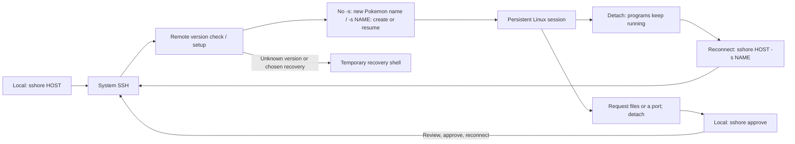

# sshore

[](https://github.com/jay-waves/sshore/actions/workflows/ci.yml)

Disconnect from SSH without stopping your remote shell. Reconnect to pick up where you left off.

**Local:** Linux or Windows, amd64/x86-64. **Remote:** Linux amd64/x86-64. Requires OpenSSH; ARM and macOS are not supported.

## Quick start

```sh
sshore myserver                 # New session with an automatic Pokemon name.
# Press Ctrl-] to detach and keep programs running.
sshore myserver -s pikachu      # Resume the name printed when connecting.
sshore myserver -s build         # Use a separate named session.
sshore myserver list             # List sessions and foreground programs.
```

Uses your normal SSH aliases, keys and authentication. Inside the remote shell, `sshore detach` also detaches; `exit` ends the session. Multiple connections to a host use separate sessions; only one client can attach to each session at a time. Without `-s`, every connection creates a new session, including after a disconnect. Use the printed name to reconnect.

Automatic names come from 24 familiar Pokemon, starting with `pikachu`, `eevee`, `bulbasaur`, `charmander`, `squirtle`, `snorlax`, `psyduck` and `gengar`. Each has a bundled color Unicode sprite on connection in a color-capable terminal. `-q` or `NO_COLOR=1` hides the sprite; monochrome and redirected output show only connection text. Detached sessions keep their names. If all 24 are in use, choose any custom name with `-s NAME`.



## Install

Download [release packages](https://github.com/jay-waves/sshore/releases), or use an installer:

**Linux**

```sh
curl -fsSL https://raw.githubusercontent.com/jay-waves/sshore/main/install.sh | sh
```

Installs into `~/.local/bin`. Requires `curl`, `tar` and `sha256sum` or `shasum`.

**Windows** — PowerShell 5.1 or 7, preferably in Windows Terminal:

```powershell
irm https://raw.githubusercontent.com/jay-waves/sshore/main/install.ps1 | iex
```

Installs into `%LOCALAPPDATA%\sshore\bin`; set `$env:INSTALL_DIR` to choose another directory. Close running copies before upgrading.

Installers verify checksums and do not change PATH or request elevation. Use the printed executable path or add its directory to PATH yourself. You can download and inspect either script before running it. For a pinned version, use `sh install.sh --version 0.4.6` or `.\install.ps1 -Version 0.4.6`.

The remote program is installed automatically if missing. Existing programs and sessions require confirmation before updating; see below.

## Connect

```sh
sshore user@host -p 2222 -i ~/.ssh/id_ed25519
sshore myserver -J jump
sshore connect forward          # Host alias named like a command.
sshore myserver --server /home/alice/bin/sshore
```

Put recurring connection settings in `~/.ssh/config`. Run `sshore --help` for all supported options.

| Option | Use |
| --- | --- |
| `-s NAME` | Create or resume a named session; omit for a new automatic name |
| `--server PATH` | Remote executable; default: PATH, then `~/.local/bin/sshore` |
| `--download-dir DIR` | Default local save directory; approval still required |
| `--no-escape` | Send Ctrl-] to the remote program |
| `-q` | Hide session art and periodic transfer progress |
| `-V` / `-h` | Version / help |

## Transfer files

**In the remote shell:**

```sh
sshore upload                   # Request an upload to the current directory.
sshore upload /tmp/uploads       # Request an upload to this directory.
sshore download ./report.zip
sshore download a.zip b.log      # Up to 16 files per request.
```

The request detaches you; your remote programs keep running. **In your local shell:**

```sh
sshore approve                  # Review, choose local paths, transfer, reconnect.
sshore approve --stay           # Transfer and remain local.
sshore approve --list            # List pending requests.
sshore approve ID --reject       # Discard a request.
```

For one upload, submitting the source path approves it. Downloads and other requests ask for `yes`. Ctrl-C cancels local approval or transfer. Requests expire after 10 minutes; request again after a failed reconnect. A normal connection never executes pending requests.

**Path input:** Tab completes a shared prefix or shows a small list. Further Tabs cycle; Enter selects, then another Enter submits. Large lists ask you to type more. Directories are colored; `NO_COLOR=1` disables colors. Spaces, Unicode, surrounding quotes and `~/` work. For downloads, Enter accepts the suggested path. Use `--` before remote paths starting with `-`.

Transfers support regular files only and never overwrite an existing destination. No directories, symlinks, resume or drag-and-drop. The destination filesystem must support hard links (for example NTFS on Windows). A failed batch keeps files already completed.

## Forward a port

**In the remote shell:**

```sh
sshore forward 3000
```

Then run `sshore approve` locally and open `http://127.0.0.1:3000`. Use `sshore approve --stay` to keep the tunnel in the local foreground; Ctrl-C closes it.

Dynamic forwards use the same local and remote TCP port on IPv4 loopback. Detaching or disconnecting closes them; reconnecting does not restore them. In the remote shell, `sshore forward --list` lists rules and `sshore forward --stop 3000` closes one. A new request detaches and closes the previous rule.

For different ports or multiple rules, use native SSH forwarding at connection time:

```sh
sshore myserver -L 127.0.0.1:8080:127.0.0.1:3000
sshore myserver -D 127.0.0.1:1080   # SOCKS proxy.
```

Native `-L`, `-R` and `-D` rules are managed by OpenSSH, separately from `sshore forward`.

## Update or recover

Client and remote programs must match **exactly**, including the patch version. A newer remote version requires upgrading your local client; sshore never automatically downgrades it.

When an older remote installation or session is found:

- **Type `update`** to install the matching version and end the listed old sessions and their tasks. Save your work first; this can disconnect other clients on the same account.
- **Press Enter** for a temporary recovery shell on the same SSH connection. Existing sessions remain running. Persistence, file transfer, approvals, dynamic forwarding and Ctrl-] detach are disabled in recovery. Exit and reconnect for normal use.

Unknown versions or a failing remote version check require manual recovery. Pending approved operations are skipped after a setup update or in recovery; request them again. If downloading the matching release fails, use ordinary `ssh HOST` for maintenance.

## Troubleshooting

| Symptom | Try |
| --- | --- |
| Session already attached | Use a different `-s NAME` or omit `-s` for a new session; detach the current client to resume that same session. |
| Screen looks stale after reconnecting | Press Ctrl-L or use the application's redraw command. |
| Missing output while disconnected | Expected: screens, scrollback and detached output are not saved. |
| Session disappeared | Shell exit, reboot or system session-cleanup policies can end it. |
| Transfer destination exists | Choose another filename; overwriting is disabled. |
| Forwarded port fails | Check that the local port is free and the remote service is running. |
| SSH / connection failure | Try `sshore HOST -vvv -E ./ssh-debug.log`; keep noninteractive shell startup output quiet. |
| Daemon startup failure | On the remote host, check session `.log` files under `$XDG_RUNTIME_DIR/sshore` or `/tmp/sshore-UID`. `SSHORE_RUNTIME_DIR` overrides this location. |

There is no automatic reconnection. SSH agent/X11 forwarding may not survive reattachment. For command help, use `sshore help download` or `sshore download --help`.

## Security, development and credits

Read [SECURITY.md](SECURITY.md) for approval boundaries, update safeguards and remaining risks. Implementation notes live in the corresponding source-file headers.

Build from source with Go 1.25+: `go build -o dist/sshore .`. Source builds need matching binaries on both ends. CI builds Linux/Windows amd64 and publishes main; full tests run manually via [Actions → Tests → Run workflow](https://github.com/jay-waves/sshore/actions/workflows/tests.yml).

Inspired by [dtach](https://github.com/crigler/dtach), the original `dssh.nu` prototype and [trzsz](https://github.com/trzsz/trzsz). Terminal Pokemon artwork comes from [pokemon-colorscripts](https://gitlab.com/phoneybadger/pokemon-colorscripts) by Phoney badger, vendored from the [Findarato mirror](https://github.com/Findarato/pokemon-colorscripts); see [third-party notices](THIRD_PARTY_NOTICES.txt). Uses [OpenSSH](https://www.openssh.com/), [smux](https://github.com/xtaci/smux) and [creack/pty](https://github.com/creack/pty). sshore does not interoperate with SFTP or trzsz.

[MIT license](LICENSE). Dependencies retain their own licenses; versions are in [go.mod](go.mod).
