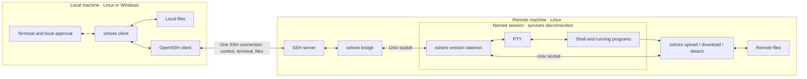

# sshore

[](https://github.com/jay-waves/sshore/actions/workflows/ci.yml)

A small SSH command-line tool: disconnect while your remote shell keeps running, then reconnect to the same process. Supports multiple named sessions, with one attached client per session.

The server runs on Linux; clients run on Linux and Windows. Remote file and port requests detach first; a separate local `sshore approve` command reviews and executes them over a new connection. Authentication, keys, agent use and host-key checks remain with system OpenSSH. See [SECURITY.md](SECURITY.md) for the trust model.

## Architecture



Each named session keeps its shell running independently of the SSH connection. Use `-s NAME` with the same host to resume; only one client can attach at a time.

## Install

Prebuilt binaries do not require Go. After a successful CI run, download Linux or Windows packages for amd64 or arm64 from the [Actions artifacts](https://github.com/jay-waves/sshore/actions). Download archives and SHA-256 checksums from [Releases](https://github.com/jay-waves/sshore/releases). Starting with 0.3.0, releases use full version tags (for example `v0.3.0`); a published version is not moved to a later commit. Verify downloaded archives against `SHA256SUMS`. Older rolling releases remain available.

On a Linux host (amd64 or arm64), run the installer yourself:

```sh
curl -fsSL https://raw.githubusercontent.com/jay-waves/sshore/main/install.sh | sh

# Install the exact version matching your local client.
curl -fsSL https://raw.githubusercontent.com/jay-waves/sshore/main/install.sh | sh -s -- --version 0.3.2

# Optional custom installation directory.
curl -fsSL https://raw.githubusercontent.com/jay-waves/sshore/main/install.sh | sh -s -- --version 0.3.2 --bin-dir "$HOME/bin"
```

The script detects Linux/CPU architecture, downloads a published release over
HTTPS, verifies its SHA256SUMS entry and installs atomically into `~/.local/bin`.
It requires `curl`, `tar`, and `sha256sum` or `shasum`, does not use sudo or modify
shell profiles, and preserves a recognized old binary as `sshore-X.Y.Z` if that
backup does not already exist. It does not stop or upgrade running daemons.
macOS and other server operating systems are not supported. To inspect the script first, download the same URL to a file
and read it before running `sh install.sh`.

On Windows (amd64 or arm64), use Windows PowerShell 5.1 or PowerShell 7:

```powershell
# Latest published Windows client. Does not change PATH.
irm https://raw.githubusercontent.com/jay-waves/sshore/main/install.ps1 | iex

# Optional installation directory, including paths with spaces.
$env:INSTALL_DIR = 'D:\Tools\sshore'
irm https://raw.githubusercontent.com/jay-waves/sshore/main/install.ps1 | iex

# Download, inspect, then install a specific version.
Invoke-WebRequest -UseBasicParsing https://raw.githubusercontent.com/jay-waves/sshore/main/install.ps1 -OutFile install.ps1
.\install.ps1 -Version 0.3.4
```

The default directory is `%LOCALAPPDATA%\sshore\bin`; `INSTALL_DIR` overrides it.
The script verifies SHA256SUMS and the executable version before replacing
`sshore.exe`. It never modifies process/user/system PATH, PowerShell profiles, or
execution policy. It prints the full executable path and optional PATH setup
instructions. Windows ZIP packages remain available for manual installation.

Choose a writable installation directory, close running copies of `sshore.exe`
before upgrading, and back up any version you want to keep. The Windows installer
does not maintain versioned backups or stop processes. Configure persistent PATH
and any script execution policy yourself, and select a client version compatible
with the remote server. Installer failures do not trigger elevation or environment
repair.

A connection probes for the remote executable in the same SSH session. If it
is missing, sshore prints an installation command pinned to the local client's
version, then exits. **It never runs the installer automatically.** Log in using
ordinary `ssh`, run the displayed command remotely, then reconnect with sshore.
The default executable lookup checks PATH, then `~/.local/bin/sshore`. An explicit
`--server PATH` is respected without fallback. Authentication failures or protocol
mismatches are not treated as a missing installation.

Building from source requires Go 1.25+. The local machine needs an OpenSSH client (`ssh` or `ssh.exe`), and the remote machine needs a working SSH server.

```sh
git clone https://github.com/jay-waves/sshore.git
cd sshore
go build -o dist/sshore .

# Cross-compile the Windows client on Linux.
CGO_ENABLED=0 GOOS=windows GOARCH=amd64 go build -buildvcs=false -o dist/sshore.exe .
```

Install the Linux binary on the remote PATH, for example as `~/.local/bin/sshore`, and install the appropriate binary locally. Use the same version on both ends; connections check the protocol version. No root access or additional listening network port is required.

Versions 0.3.1 and 0.3.2 use protocol 4 for local approvals. Update both binaries together.
Exit existing protocol 3 session daemons using the old client before upgrading;
running daemons cannot upgrade in place.

Version 0.2 uses a new multiplexing protocol that is incompatible with 0.1. Before upgrading, attach to any running 0.1 sessions with the old client and exit their shells, then replace both binaries. Running session processes cannot upgrade their protocol in place.

```sh
# Install on the Linux server.
install -Dm755 dist/sshore "$HOME/.local/bin/sshore"
```

The default lookup also checks `~/.local/bin/sshore` when noninteractive SSH omits that directory from PATH. For a custom installation, specify an absolute remote path:

```sh
sshore myserver --server /home/alice/.local/bin/sshore
```

Run the Windows client in a modern console with VT support, such as Windows Terminal. The Windows binary is a client; session and file commands run inside the connected Linux shell.

Input-mode cleanup temporarily enables VT output and restores the previous Console mode, including when approval runs before raw input is enabled. On Unix, cleanup is sent only to a TTY with `TERM` other than `dumb`. Detach and exit disable mouse reporting, focus reporting, and bracketed paste before restoring local input settings. During connection, remote terminal output is passed through unchanged. On Windows, native mouse capture starts disabled and follows remote mouse requests, so turning off Quick Edit does not accidentally enable mouse reports in a plain remote shell.

## Connect and manage sessions

```sh
sshore user@host                 # Create a new automatically named session.
sshore myserver -s build         # Create or attach to the build session.
sshore myserver list             # List sessions, shell PIDs, attachment status, and foreground programs.
sshore myserver -J jump -p 2222   # Pass SSH connection options.
sshore myserver --download-dir ./downloads  # Default save directory; still requires approval.
```

sshore uses system OpenSSH configuration, host keys, and authentication settings. Supported SSH options are `-p`, `-i`, `-J`, `-F`, `-l`, `-o`, `-L`, `-R`, `-D`, `-E`, `-C`, `-v`, `-vv`, `-vvv`, `-4`, and `-6`. Options taking values accept separated or attached forms (for example `-p 2222` or `-p2222`); forwarding options may be repeated. Put complex settings in `~/.ssh/config`. Not every OpenSSH option is forwarded. If a host alias conflicts with a built-in command, configure another SSH alias for that host.

`list` shows foreground program names (such as `bash`, `vim`, or `python`), without command-line arguments or background jobs. Multiple foreground processes are joined with ` | `; `—` means the information is unavailable.

Session names contain 1-48 ASCII letters, digits, underscores, or hyphens, starting with a letter or digit. An attached session rejects a second client; clients cannot take over a connection or share input.

Without `-s`, every connection creates a new session using an available Pokemon English name (for example `pikachu` or `eevee`), without a suffix. Attached and detached sessions both reserve their names. If all automatic names are occupied, the command reports an error; exit an existing session or use `-s NAME` to choose another name. The connection message shows its name. Use `sshore myserver list` to find existing sessions and `sshore myserver -s NAME` to reconnect.

Inside the remote shell, run `sshore detach` to leave the session running, or `exit` to end it. Reconnect with the same command, for example `sshore myserver -s build`.

## Approve from the local shell

Remote `upload`, `download` and `forward PORT` commands register a request and
detach. The remote shell and its programs keep running; current transfers and
dynamic forwards close. A successful remote command means **queued**, not completed.

```sh
sshore approve                 # Review the only pending request; execute and attach.
sshore approve ID --attach     # Explicitly return to the original remote shell.
sshore approve ID --stay       # Complete files and return to the local shell.
sshore approve --list          # List unexpired requests.
sshore approve ID --reject     # Delete a pending request without reconnecting.
```

For port forwarding, `--stay` keeps a foreground tunnel running without remote
terminal interaction; Ctrl-C closes it. It does not return a shell prompt while
the tunnel is active. Use another local terminal for other commands.

Approval displays the connection target and exact operations, asks for local
file paths, then requires `yes`. SSH reconnects using the original options;
OpenSSH may ask for a key passphrase, password or MFA as usual. There is no
separate approval password. `--attach` and `--stay` are mutually exclusive.

Requests expire after 10 minutes and are consumed before connecting. Failure,
cancellation or a changed/ended session requires a new request. No automatic
retry or persisted grant exists. The original shell PID must match on reconnect.
Normal `sshore HOST -s NAME` never executes pending requests.

Pending records live under the local user configuration directory in
`sshore/approvals` (override the parent with `SSHORE_STATE_DIR`). They contain
connection options and operation metadata, not collected SSH credentials.
Unix state must be owned by the current user with private permissions; Windows
state gets a current-user-only DACL. Up to 32 pending records are retained.

Each sshore connection disables OpenSSH ControlMaster/ControlPath/ControlPersist
sharing, so exiting owns and closes its transport without terminating someone
else's shared master. Other locally configured SSH features remain in effect.

## Forward ports

Inside the remote shell, forward a service to the same port on your computer:

```sh
sshore forward 3000          # Request local 3000 -> remote 3000, then detach.
sshore forward --list        # Show this connection's dynamic forwards.
sshore forward --stop 3000   # Close the listener and its existing connections.
```

Open `http://127.0.0.1:3000` locally for a remote HTTP service. Only TCP over
IPv4 loopback is supported. After local approval, an occupied local port reports
an error without selecting a different port. Opening the local listener does
not establish that the remote service is running. A failed
remote connection closes that local TCP connection; the listener remains usable.

Rules belong to the attached client. Detach, disconnection, or shell exit closes
all dynamic listeners and their connections. Reconnecting starts with no rules;
remote services continue running with the persistent shell. A remote approval contains one port; up to 32 simultaneous forwarded TCP
connections are supported for that attachment. A new approval detaches and
closes the previous rule. Excess
connections are closed. Forwarding uses separate streams and does not occupy
file-transfer slots, but shares SSH bandwidth with the terminal and files.

For different ports or destinations, pass native OpenSSH `-L` options at startup
(repeat `-L` for multiple rules):

```sh
sshore myserver -s dev -L 127.0.0.1:8080:127.0.0.1:3000
```

`forward --list` and `--stop` manage only dynamic rules; OpenSSH manages `-L`
rules separately. Both use the same local port namespace, so conflicting
listeners fail. Dynamic forwarding is implemented by sshore over the command
channel; it does not depend on OpenSSH ControlMaster support.

Other lightweight OpenSSH options are passed through for each connection:

```sh
sshore myserver -R 127.0.0.1:9000:127.0.0.1:3000  # Remote 9000 -> local 3000.
sshore myserver -D 127.0.0.1:1080                 # Local SOCKS proxy.
sshore myserver -vvv -E ./ssh-debug.log           # Detailed SSH diagnostics.
sshore myserver -C                              # Optional SSH compression.
```

`-C` is optional because compression can add overhead on fast links or with
already-compressed files. `-E` captures OpenSSH diagnostics, not sshore's own
messages. `-q` remains sshore's transfer-progress option. Forwarding permissions
and bind-address rules for `-L`, `-R`, and `-D` remain controlled by OpenSSH.

## Transfer files

Run these commands inside the remote shell; each queues an approval and detaches:

```sh
sshore upload                   # Request upload into the current remote directory.
sshore upload /tmp/uploads       # Request upload into this remote directory.
sshore download ./report.zip     # Request one download.
sshore download a.zip b.log c.png # Request a batch (maximum 16 files).
```

Run `sshore approve` locally to choose paths and approve. UTF-8 paths, spaces,
surrounding quotes and `~/` work; command substitution and wildcard expansion
are not performed. For downloads, Enter accepts the displayed default path.
`--download-dir` changes that default, never bypasses approval.

Batch paths are checked before queuing. Approved files transfer sequentially;
the first failure stops execution and completed files remain. The local approve
command reports execution failures. Ctrl-C cancels approval or an active file
operation and leaves the remote shell running. No sensitive file prompt is
shown inside the remote terminal anymore. Ctrl-] still detaches during normal
remote interaction; Ctrl-C goes to the remote program there.

## Command reference

Common options:

| Option | Purpose |
| --- | --- |
| `-s, --session NAME` | Create or resume this session; omitted: create a new Pokemon-named session |
| `--server PATH` | Remote sshore executable; defaults to PATH, then `~/.local/bin/sshore` |
| `--download-dir DIRECTORY` | Existing local directory used as the default during approval; never grants automatic acceptance |
| `-q, --quiet` | Hide periodic progress while retaining prompts, completion messages, and errors |
| `--no-escape` | Forward Ctrl-] to the remote application; use `sshore detach` to disconnect |
| `-h, --help` | Show help; accepted before or after connection arguments |
| `-V, --version` | Show the version |

Use `sshore help download` or `sshore download --help` for command help. Put `--` before paths that begin with a hyphen, for example `sshore download -- -report.txt`. Invalid arguments return exit code `2`; other failures return a nonzero code. A normal remote shell exit preserves its exit code.

Local messages use your terminal’s ANSI 16-color palette: cyan for information and progress, green for success, yellow for cancellation and warnings, and red for errors. Set `NO_COLOR=1` to disable colors. Redirected output and `TERM=dumb` remain plain text.

## Behavior and limitations

- Sessions preserve the shell, working directory, environment variables, and running programs. Terminal screens and scrollback are not saved or restored. Press `Ctrl-L` after reconnecting if a redraw is needed.
- Output produced while detached is discarded. There is no automatic reconnection; reconnect with `sshore HOST -s NAME`.
- The session ends when its shell exits. Reboots, process termination, or system login-session cleanup policies can also end it.
- Uploads and downloads execute after local approval, before remote terminal interaction resumes. Only ordinary files are supported, without directories, symbolic links, resumable transfers, drag and drop, or nested SSH. File transfers do not interoperate with SFTP or trzsz.
- Transfers verify file size and SHA-256 and never overwrite existing files. Cancellation and disconnection remove incomplete files; a forcibly killed receiver or system crash may leave `.sshore-*.part` files.
- Publishing requires hard-link support on the destination filesystem, such as common Linux filesystems or Windows NTFS. Unsupported filesystems produce an error, without falling back to an operation that might overwrite a file. Permissions, timestamps, and other metadata are not copied. Received files default to `0600` on Linux and inherit the destination directory's ACL on Windows.
- Local approval and path selection happen before SSH starts. During approved transfers and `--stay`, remote terminal output is not displayed; normal server output is discarded during this phase. There is no screen replay when attachment resumes.
- The Linux daemon does track standard 7-bit xterm mouse mode sequences (including changes while detached or muted), and restores the current mouse modes on attachment. This requires an updated daemon; existing session daemons keep running their original binary.
- After restoring mouse state, reattachment requests a redraw with `SIGWINCH` to the PTY foreground process group, even when the size is unchanged. Approved attachment waits until output resumes before requesting the redraw; `--stay` does not request one. This is best effort: applications may ignore the signal or omit mode reinitialization.
- Automated tests cover sshore mouse-state recovery and foreground redraw notification, not individual terminal or multiplexer rendering. Configure your terminal/multiplexer and use its redraw or detach/reattach controls when needed; Zellij 0.45.1 can leave unchanged cells unpainted on a same-size notification. Screen contents, focus/paste/extended-keyboard state, and terminal-specific passthrough wrappers are not emulated. Keep terminal capabilities compatible when reconnecting to an existing session.
- SSH agent and X11 forwarding environments come from the connection that created the session and are not refreshed on reconnect. Forwarding is not guaranteed to remain usable after reconnecting.
- Login scripts that print to stdout for noninteractive SSH connections interfere with the protocol handshake. Restrict such output to interactive shells.

## Runtime directory

sshore prefers `$XDG_RUNTIME_DIR/sshore`, falling back to `/tmp/sshore-UID`. The directory must belong to the current user with mode `0700`. Override it with `SSHORE_RUNTIME_DIR`, using a short absolute path under an existing parent directory. Unix socket paths have a limited length.

If a connection fails, check the session's `.log` file in the runtime directory for background errors. Logs may remain after a session exits; use `sshore HOST list` to check active sessions.

## Acknowledgments and references

Thanks to the authors and maintainers of these projects:

- [dtach](https://github.com/crigler/dtach): a reference for keeping a terminal process alive independently of its attached client, with a deliberately small detach/attach model.
- The original `dssh.nu` prototype supplied for this project: the starting point for combining SSH with persistent named sessions.
- [trzsz](https://github.com/trzsz/trzsz) and [trzsz-go](https://github.com/trzsz/trzsz-go): inspiration for initiating file transfers from a remote shell with local interaction. sshore implements its own protocol and does not use or interoperate with trzsz.
- [OpenSSH](https://www.openssh.com/): the external SSH client and server providing authentication, encryption, and connection configuration.
- [smux](https://github.com/xtaci/smux): the Go dependency providing stream multiplexing and flow control over the SSH transport.
- [creack/pty](https://github.com/creack/pty): the Go dependency providing Linux PTY creation and resizing.

References and inspiration are distinct from runtime dependencies. Dependency versions are recorded in `go.mod`; each upstream project retains its own license.

## License

[MIT](LICENSE).
