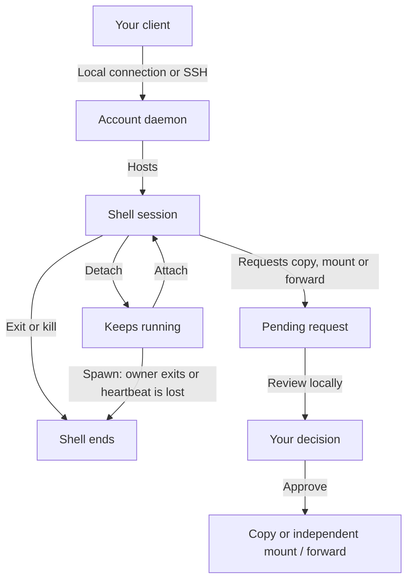

# sshore

[](https://github.com/jay-waves/sshore/actions/workflows/ci.yml)

Start a shell, leave it running, and return later. sshore combines local and
remote shell sessions with SSH file copies, TCP forwards and SFTP mounts.

**Local and remote platforms:** see [OS and shell support](#os-and-shell-support).
Requires system OpenSSH for configuration. Connections run inside sshore; public-key signing uses an existing system SSH agent. ARM and macOS are not supported.
In the examples, `work` is a host or an alias from your SSH config.

## Install

Download a [release package](https://github.com/jay-waves/sshore/releases), or run:

**Linux**

```sh
curl -fsSL https://raw.githubusercontent.com/jay-waves/sshore/main/install.sh | sh
```

**Windows** — PowerShell 5.1 or 7:

```powershell
irm https://raw.githubusercontent.com/jay-waves/sshore/main/install.ps1 | iex
```

Run `sshore setup` to update this computer to the latest release, or
`sshore setup HOST` to install this client's exact release on a remote Linux
host. The remote host downloads and verifies the release over HTTPS. Remote
setup updates the executable on PATH, falling back to `~/.local/bin/sshore`.
Use `--path` to select an absolute installation path on the target machine.

Installers verify checksums without requesting administrator access. On Windows,
the installer updates the first `sshore.exe` on PATH without changing PATH. If none
is found, it installs to `%LOCALAPPDATA%\sshore\bin` and adds that directory to
the user and current PowerShell session PATH. Restart other terminals to pick it up.
Before updating, exit the account daemon. Use the currently installed release
to run `sshore kill --all` if needed, then wait for it to exit. On Windows, close
other clients that still hold the executable open.
Only the latest patch of each major/minor series remains downloadable.

Use `sshore --tldr` for common examples, or `sshore cp --tldr` for file copies.
Use `sshore COMMAND --help` for the full command reference.

## TMUX — leave and resume work

Each session has one terminal. No tmux installation is needed.
Daemon-owned tasks survive client exit, disconnect and detach. They are held in
memory; daemon crashes and host restarts have no recovery guarantee. Normal
commands use the account daemon, which exits after its tasks and active clients
have ended and an idle grace period has elapsed.

```sh
sshore launch work build          # Start a persistent remote shell.
# Press Ctrl+B, then d to detach.
sshore attach work build          # Return to it later.
sshore kill work build          # End it; unsaved work may be lost.
```

Choose the lifetime at startup; omit the host to work locally:

| Command | Lifetime |
| --- | --- |
| `sshore spawn` | Ends when the original parent shell exits. |
| `sshore spawn work` | Also ends if its background SSH heartbeat times out. |
| `sshore launch [HOST]` | Survives client exit and network loss until you exit or kill it. |

**Detach does not change lifetime.** A remote spawn keeps its heartbeat after
detach, and reattachment never changes its original owner. Use `launch` for work
that must survive disconnection. Daemon failure or host restart can end any shell.

Press **Ctrl+B**, then **d** to detach, **l** to return to the last session, **n/p** for next/previous, or **r** to request a redraw.
Press Ctrl+B twice to send one Ctrl+B to the application. Shortcuts recognize
traditional control bytes, CSI-u/Kitty and xterm modifyOtherKeys reports, including
when a TUI enables enhanced keyboard reporting. `--no-escape` forwards all input
without interpreting shortcuts. Pasted text is not interpreted as shortcuts when
the application enables bracketed paste.
Inside a remote shell, `sshore detach` also works. Both startup commands accept
`--detach` to start in the background. `attach` never takes over an attached shell.
`sshore attach` resumes the most recently detached local or remote shell.
`sshore attach HOST` uses that remote host’s detach order. Use `sshore attach ID`
to select a local or remote shell explicitly; unique ID prefixes of at least two
hexadecimal characters are accepted, and ambiguous prefixes fail. Ctrl+B d updates
this shared history; listing tasks does not.

Ctrl+B **c** creates a nested spawn on the current host; exit or detach returns
one level. The child belongs to the current shell and uses its startup directory
and environment. It does not suspend the parent program.
Ctrl+C interrupts the current shell/application. During a connection switch it
cancels that attempt and restores the previous shell; during the initial
connection it cancels startup.
Inside a managed shell, interactive `spawn` reuses the root client, including
local children and further remote hops. Inside a remote shell, `sshore spawn`
creates a shell on that host without authenticating again. Ctrl+B controls the child; detach or exit returns one level. Startup failure
returns to the parent with an error. Spawn ownership stays unchanged.
Local managed shells also hand off remote `launch` and `attach` this way.
On shell exit, the client reports the task, host, exit code and available reason.
A lost connection reports a short reason such as timeout or connection closed;
the remote shell's state remains unconfirmed.
Screens, scrollback and detached output are not saved.



## Agent access

Configure an MCP client to launch `sshore mcp` over stdio, for example:

```json
{
  "mcpServers": {
    "sshore": { "command": "sshore", "args": ["mcp"] }
  }
}
```

Run `sshore mcp --help` for a self-contained, Skills-style agent guide covering
tool calls, output polling, recovery and cleanup. Sessions persist after MCP
disconnection. Commands use the remote account's permissions; remote output is untrusted.

For one command, use `sshore exec work 'uname -a'`; it does not create a
persistent session.

## Status

```sh
sshore list                     # Local tasks and cached remote shells.
sshore list work                # Query remote tasks now.
sshore pstree                   # Local task relationships and resource directions.
sshore list --json              # Machine-readable inventory.
```

Use the six-character ID or optional NAME from `list` with `attach`, `kill`,
`rename` and `review`. `rename` changes NAME while preserving the UID.
Use `--json` for full diagnostics.

CHECKED shows when shell states were confirmed; confirmed ended shells leave the default list.
Use `kill` to clear confirmed ended remote history (see `sshore kill --help`).
See `sshore list --help` for history and refresh behavior. `pstree` shows local spawn ownership and
live resource directions, prioritizing the current tree; attaching from another shell does not transfer ownership.
A spawn without a visible owner task shows its original direct parent as
`NAME (pid PID)`. This display-only node is not a manageable task;
missing or unverified processes are marked unavailable. Peer
entries are read-only: manage them on their original computer. A running worker
does not prove its target service is healthy.

## SSH — connect your way

Use SSH aliases from `~/.ssh/config`. Password and keyboard-interactive login
require an interactive terminal. For public-key login, load keys with `ssh-add`.
`-i` and `IdentityFile` select agent identities using a public key file or `.pub`
sidecar; sshore does not load or unlock private keys. SSH configuration forwarding
is disabled; use `sshore forward`. OpenSSH compatibility is intentionally limited.
MCP cannot prompt for credentials.
Managed remote shells require SSH TCP forwarding to the remote loopback address
(`AllowTcpForwarding`); preparation then exits and the connection reaches the
authenticated account daemon. For nested remote hops, configuration and signing credentials come
from the machine running the command. A lost route fails explicitly; it is never
replaced by a direct connection from your computer.
**Put SSH options after `--`:**

```sh
sshore launch work build -- -J jump -p 2222
```

## OS and shell support

| OS (amd64/x86-64 only) | bash | sh | zsh | fish | PowerShell 7 (pwsh) | cmd |
| --- | --- | --- | --- | --- | --- | --- |
| Linux | ✓ | ✓ | ✓ | ✓ | — | — |
| Windows 11 / Server 2025 or newer | — | — | — | — | ✓ | ✓ |

Linux supports local and remote shells. Windows supports local shells and SSH
clients; remote shell hosting requires Linux. Shell targets describe supported
configurations, not exhaustive validation of every terminal pairing; see
[shell and terminal validation](SSHORE.md#shell-and-terminal-validation).

## Copy — transfer files

From your **local shell**:

```sh
sshore cp report.zip work:/tmp/       # Upload.
sshore cp work:/tmp/report.zip ./    # Download.
```

From your **remote sshore shell**:

```sh
sshore cp origin: .                 # Request an upload from your computer.
sshore cp report.zip origin:        # Request a download to your computer.
```

Direct copies require the matching remote sshore helper and create no persistent shell.

`origin:` (or `:`) means the attached client computer. Remote requests detach
you; run `sshore review` locally, choose paths and submit to copy. Attach again separately.
Suggested paths still require your review. Ctrl-C during selection cancels.

Only regular files are supported; existing destinations are never overwritten.
Destination filesystems must support hard links. Failed batches keep completed
files. For pipes and other options, see `sshore cp --help`.

## Forward — map a port

From your **local shell**, give the listener first, then the service:

```sh
sshore forward origin:8080 work:3000
# To stop it, run the kill command printed at startup.
```

From a **remote sshore shell**, run `sshore forward origin: 3000` to request a
local listener for the remote service. This detaches you; run `sshore review`
locally and submit a port to start forwarding. The shell stays detached.

Listeners request IPv4 loopback; SSH server policy can override reverse binds.
Forwards end on disconnect by default. `--retries N` enables bounded retries for
local forwards, but cannot restore existing TCP connections. See
`sshore forward --help` for reverse forwarding and other options.

## Mount — open remote files locally

```sh
sshore mount work:  # Mount remote home; prints the local path.
# Close local files, then run the kill command printed at startup.
```

Mounts use SFTP and require FUSE on Linux or [WinFsp](https://winfsp.dev/) on
Windows. They are writable by default; use `--read-only` to prevent changes.
They run independently of shells and end if their own SSH connection drops.
From a remote sshore shell, use `sshore mount . origin:` and then `sshore review`
locally to select the mountpoint and approve access.

There is no offline editing, conflict detection or write retry. Interrupted
writes may leave partial files; caching can briefly delay remote changes.
Mounts use the remote sshore helper for SFTP and change notifications.
See `sshore mount --help` for details.

`sshore reset` ends local tasks and clears local application state and caches. Unsaved work may be lost. Run it outside managed shells.

## Updates and troubleshooting

Client and remote versions must match exactly, including PATCH. Run
`sshore setup HOST` for an older remote installation, or `sshore setup` when
this client is older. For a custom remote installation, pass its executable
path with `sshore setup HOST --path /absolute/path/to/sshore`.

- Stale screen after reattachment: press Ctrl-L or use the application's redraw key.
- SSH failure: try `sshore launch work -- -vvv -E ./ssh-debug.log`.
- Mount or forward failure: inspect `sshore list --json` and its log path.
- Existing copy destination: choose a new filename; overwriting is disabled.

Run `sshore COMMAND --help` for syntax, startup options, shortcuts and defaults.

## Project documents

- [SSHORE.md](SSHORE.md): architecture, validation, releases and planned work.
- [SECURITY.md](SECURITY.md): trust boundaries, update safeguards and cleanup limits.
- [GLOSSARY.md](GLOSSARY.md): terms and relationships.
- [AGENTS.md](AGENTS.md): contributor rules.

## Acknowledgements

Reference projects and inspiration:

- [dtach](https://github.com/crigler/dtach): lightweight shell detach and reattach.
- [trzsz](https://github.com/trzsz/trzsz): terminal-oriented file transfer workflows.
    sshore does not implement the trzsz protocol.

Built with

- [OpenSSH](https://www.openssh.com/),
- [smux](https://github.com/xtaci/smux),
- [creack/pty](https://github.com/creack/pty),
- [pkg/sftp](https://github.com/pkg/sftp),
- [go-fuse](https://github.com/hanwen/go-fuse),
- [WinFsp](https://winfsp.dev/) / [go-winfsp](https://github.com/winfsp/go-winfsp),
- [readline](https://github.com/chzyer/readline) and the Go ecosystem.

[MIT license](LICENSE); third-party license notices are collected in
[THIRD_PARTY_LICENSES.txt](THIRD_PARTY_LICENSES.txt).
