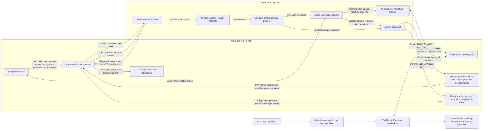

# Security model

sshore trusts the **local OS, user account, terminal, executable and SSH configuration**. The remote host may be compromised, including its root user, session daemon and programs running as your remote account. SSH authenticates the endpoint and protects transport; it does not make the endpoint trustworthy.

## Trust boundaries

Remote terminal output is untrusted. It can imitate local messages, but cannot itself grant approval. Sensitive prompts run after the connected client exits, from a **separate local invocation**. Do not invoke approval or enter credentials merely because remote output asks you to.

`new` reserves a fresh session, with an automatic or explicit name, including when other sessions are detached. `attach` requires an existing session and never evicts its attached client. Selection without a name lists detached sessions; setup and exclusive attachment are rechecked after selection without holding the account lock while waiting for user input. The local session picker starts only after SSH authentication and releases terminal input before attachment. It does not authorize updates or file/port operations. Session listings show same-user process descendants with sanitized names and PIDs; they do not expose command-line arguments or environment variables. Foreground
summaries include same-user process names and a shortened working directory,
which may reveal project names. These are best-effort snapshots, never process
identity evidence for signaling.

Rename requires matching client, installed program and daemon releases. The account
setup lock serializes label changes and name allocation; immutable socket identities
preserve inherited helper connections. Private name metadata and daemon lifetime
locks keep names reserved even when a daemon stops responding; name resolution
does not depend on other sessions answering status requests. Pending approvals are not rewritten: their
original name and shell PID must still match, otherwise they fail closed.

Exit diagnostics store only session name, time and reason in private `0600` files
inside the remote runtime directory. Keep at most 100 receipts for seven days;
records are best effort and do not prove task cleanup. Explicit kill/update reasons
are recorded only after verified cleanup succeeds. Abrupt termination or runtime
removal can prevent recording. No terminal content, command arguments or working
directories are retained in exit records.

## Local approval

Receiving a request saves only bounded metadata. It does not open a requested listener or read/write a user-selected transfer file. Requests cannot encode a local shell command or choose an upload source. Unsolicited transfer offers and forward-add streams are rejected. `--download-dir` is a default, not consent.

For a single upload, submitting the local source path after reviewing the target and destination is explicit approval. Other requests require `yes`. Completion only browses the local filesystem in this approval process; selecting a completion candidate does not submit the operation.

Pending records:

- Expire in 10 minutes, with at most 16 operations per request and 32 pending records.
- Store connection options and operation metadata, not collected SSH credentials. Unix state requires current-user ownership and private permissions; Windows state uses a current-user-only DACL.
- Are consumed before reconnecting, even if connection or execution fails. There is no persisted grant or automatic retry; a normal connection never executes them.
- Retain the original session and shell PID. Approval must not silently create a new shell. PID matching detects accidental replacement, not a malicious server lying about its identity.

OpenSSH owns passwords, keys, agents, MFA and host-key checks. No separate approval password is collected; an SSH login without a prompt is not consent. Local SSH configuration and executable selection remain trusted. sshore disables ControlMaster sharing for its own connection so closing it does not terminate another connection's shared master; configured proxies/jump hosts may have independent lifetimes.

## Files and forwarding

| Threat | Protection and limit |
| --- | --- |
| Path traversal or overwrite | Validate the offered basename; the user chooses the local destination. A temporary file and atomic hard link publish without overwriting. No overwrite-prone fallback is used. |
| Operation changed after approval | A local snapshot fixes direction, paths, name/size and port. Changed file metadata is rejected; same-size content changes remain possible. |
| Excess data or replay | Framing and buffers are bounded; received bytes cannot exceed approved size. Approval records are single-use. |
| Request flooding | Request/record limits bound saved metadata; the first accepted request detaches. Repeated disruption across reconnects remains possible. |
| Unwanted local listener or remote reachability | Approved dynamic forwards bind only IPv4 `127.0.0.1`, fail on occupied ports and close with the connection. The approved remote target may be any host the SSH server can reach, so review target addresses carefully. Loopback is not per-user isolation. |
| Terminal control injection in local messages | Displayed paths and errors are sanitized. The remote terminal byte stream itself remains unfiltered and untrusted. |

Transfers check size and SHA-256, which verifies integrity rather than provenance or safety. Downloaded content and forwarded services may be malicious. Avoid destinations that automatically load new scripts or configuration; an approved large file can still fill the disk. Only regular files are supported; metadata is not copied. Linux received files default to `0600`; Windows files inherit the destination directory ACL.

Cancellation removes incomplete files when cleanup can run. Forced termination may leave `.sshore-*.part` files; batch failure does not undo completed files. During approved operations and `--stay`, remote terminal output is suppressed. Detach/disconnection cancels connection-owned transfers and dynamic forwards. Only explicit detach preserves the remote session (including approval-request detach and completed file operations with `--stay`). Other transport loss closes the PTY and ends the daemon when detected. This uses normal terminal hangup semantics, not process-tree extermination: programs that ignore hangup or deliberately escape the terminal may survive, as with SSH. It does not promise cleanup of arbitrary reparented tasks.

Native SSH `-L`, `-R`, `-D`, agent forwarding and other configuration are explicit local policy, outside remote-request approval. They are reused on reconnect; `-R` can expose a local service to the remote host. Do not bypass host-key checks.

## SFTP mounts

`sshore ftp` is a local, explicit grant to expose a remote directory through a
system mount. It is independent of session transfer approvals: local applications
that can access the mount can read files and, unless `--read-only` is set, overwrite,
rename or delete them with the authenticated remote account's permissions. A
remote program cannot request or approve a mount. Recovery mode rejects `ftp`.

Background mounts are local workers, separate from remote shell sessions. A
private per-user record stores a random capability for loopback status/unmount
requests; control never kills a PID read from disk. An OS lock prevents duplicate
session names. Stop requires the worker's exact sshore release version. Startup
uses a temporary authenticated loopback askpass broker to collect SSH answers in
the initiating terminal; credentials are not stored in records or logs. Losing
the launcher before startup acknowledgement cancels the pending mount. Local
administrators and processes running as the same user are inside this boundary.

This connection uses the system OpenSSH host-key/authentication policy. It does
not run a remote sshore program, negotiate sshore release versions, install
software, or manage session daemons. It requires the SFTP capabilities it uses;
existing session setup/version restrictions are unchanged. Transport sharing,
backgrounding and forwarding are disabled for this independent connection.

The remote host and its filenames, attributes and data remain untrusted. The
selected root is a navigation boundary, not remote account confinement. Remote
symlinks may be followed by SFTP operations with that account's permissions;
Linux readlink results are restricted to the mounted tree so an absolute remote
link cannot redirect local tools into unrelated local files. Windows rejects
unrepresentable names rather than silently aliasing them. No claim of local-disk
locking, atomic multi-operation transactions or conflict detection is made.

Writes wait for SFTP responses; fsync requires the server extension. A response
is not proof that a compromised server stored data. There is no persistent write
spool or automatic replay. Disconnect or interruption can leave partial files;
normal shutdown attempts unmount while transport remains live. Busy mounts stay
connected for a retry. A second interrupt during shutdown or a 10-second timeout
aborts transport to release blocked callbacks; forced shutdown reports possible
incomplete writes. Close applications before stopping a mount. New files are created exclusively and
permissions are set before exposing the handle; a failed permissions operation
can leave an empty remote file. Linux read caching is invalidated on reopen; `--direct-io` bypasses it. No
write-back cache is enabled. Metadata caches, open files and directory snapshots
can show stale remote state. SFTP packets are limited to 1 MiB and each directory
listing to 100,000 returned entries and 32 MiB of response data before decoding;
exceeding a listing budget fails that operation without truncating it silently.

## Remote setup and updates

The full release version, including PATCH, is the compatibility identifier. No separate protocol compatibility counter is used. The managed scope is the current remote Unix account's visible sshore session daemons across runtime directories, excluding other users, preparation helpers and transient transport processes.

- A newer installed program or session daemon rejects an older client. Never automatically downgrade. Unknown/unordered versions, including a failed executable version check, permit manual recovery only.
- Missing software may be installed automatically when no incompatible sessions exist. Existing older installations or sessions require the user to type `update` after reviewing affected session identities.
- Preparation downloads a matching release over HTTPS and verifies its checksum and executable version. Temporary staging does not replace the installed program.
- Before ending tasks, setup takes the account setup lock, rechecks the process snapshot, then prepares and verifies the replacement on the target filesystem. Changed state requires fresh confirmation. Only confirmed same-user session processes and identified tasks are signaled, with process identity validation; no process-name-wide kill is used.
- Failure to prepare a replacement must not terminate tasks. Once confirmed termination starts, later failures cannot restore stopped tasks. Updates can disconnect other clients and lose unsaved work.
- Automatic replacement requires a user-owned regular file and a user-owned directory without group/world write permission. There is no elevation, PATH or shell-profile modification.

Explicit `sshore kill HOST NAME` authorizes immediate termination of that named session
and its identified tasks in the selected runtime directory, including an attached
session. It never enters installation or update negotiation. The client, installed
remote program and target daemon must have matching full release versions. Under
the account setup lock, it verifies a same-user daemon and its socket peer, then
uses the same process-identity-checked termination as setup (TERM, followed by KILL
for surviving identified tasks). Other sessions are excluded; unconfirmed daemons
are refused. Recovery mode does not permit this operation.

Processes that deliberately escape session ancestry/session ID, legacy binaries ignoring policy, concurrent unmanaged modifications and a compromised remote kernel/root are outside these guarantees. Process visibility may also limit what can be inspected. Diagnostics alone never terminate processes.

Installer checksums detect corruption, not compromise of the publisher/repository supplying the installer, assets and checksums. Remote preparation needs HTTPS access and a matching published asset. Standalone installers do not stop running sessions; the Windows installer does not make versioned backups. Linux installation preserves a recognized old version when its backup does not already exist. Existing published tags, releases and older assets are retained when publishing a new version.

## Manual recovery

Recovery preserves the authenticated SSH connection and starts a transient PTY shell without a persistent session daemon. Persistence, approval execution, file transfer, dynamic forwarding and Ctrl-] detach are disabled; help, version and diagnostics remain available. Normal functionality requires reconnecting.

Inherited helper socket variables are removed and new sshore binaries honor `SSHORE_DISABLED=1`. Approved operations are skipped both in recovery and after a setup update, and must be requested again.

This is a **product mode, not a sandbox**. It cannot constrain arbitrary legacy binaries or deliberately escaped/reparented tasks. Explicit native SSH forwarding remains the local user's policy.

## Outside the boundary

Approval is not a malware scan. A compromised local account/root, terminal emulator vulnerabilities, or a user approving a deceptive request defeats this boundary. Approval records are not tamper-proof against their owner. Remote processes sharing the account can request operations and disrupt sessions; a request does not prove who typed it.
