# Security model

sshore separates remote shell interaction from permission to access local files
and services. **An authenticated remote host is not necessarily trustworthy.**
Remote requests are proposals; only an explicit local command or local review
grants access.

This document describes threats, controls and their limits. Implementation and
lifecycle details belong in [SSHORE.md](SSHORE.md); terminology belongs in
[GLOSSARY.md](GLOSSARY.md).

## Scope and assumptions

The model protects local files and services from unapproved remote requests,
approvals from replay or substitution, and managed tasks from accidental takeover
or termination of the wrong process. It also limits what state and diagnostics
expose. It does not promise availability or trustworthy remote computation.

| Actor or component | Assumption |
| --- | --- |
| Local OS, account, terminal, sshore executable and SSH configuration | Trusted. Administrators and processes running as the same local user are inside this boundary. |
| Remote host, daemon and programs in the remote account | Potentially malicious. They may forge requests, metadata, terminal output and responses. |
| Network | Untrusted. Go SSH provides endpoint authentication and transport integrity under the local host-key policy. |
| Release publisher and distribution repository | Trusted to supply the installer, executable and checksums. Checksums alone do not protect against a compromised publisher. |
| Local user | Chooses commands and reviews requested access. Approval is not a malware scan or proof that the remote requester is honest. |

A compromised remote root or kernel can ignore lifecycle rules, lie about files
and process identities, or retain data. Remote-side checks protect against mistakes
and ordinary races on a cooperating host; they cannot compel a hostile host.

## Trust boundaries

```mermaid
flowchart LR
    subgraph remote["Potentially malicious remote host"]
        shell["Shell output and operation requests"]
        service["Files and services"]
        setup["Remote setup and managed shells"]
        bash["Persistent Bash: remote account permissions"]
        relay["Owning daemon: next-hop configuration and signing"]
        child["Child shell on next host"]
    end
    subgraph local["Trusted local OS and user account"]
        client["Terminal client"]
        pending["Daemon memory: bounded, expiring Request"]
        user["Local user"]
        agent["MCP client and Agent"]
        review["Separate local review: select paths, mountpoint or ports"]
        grant["Fixed operation; consume approval once"]
        resources["Selected files, forward or mount"]
        control["Account daemon TCP endpoint: authentication, task IDs and live leases"]
        update["Prepare and verify release; review tasks; type update"]
    end
    agent -->|"MCP stdio adapter; authenticated SSH"| control
    control -->|"Task-owned MCP execution"| bash
    bash -->|"Untrusted output"| agent
    shell -->|"Authenticated SSH; content remains untrusted"| client
    client -->|"Save metadata and detach; no operation yet"| pending
    pending --> review
    user --> review
    review --> grant
    grant -->|"Revalidate original shell; reject changed setup"| resources
    user -->|"Explicit cp / forward / mount command"| resources
    resources <-->|"Authenticated SSH; remote account permissions"| service
    user -->|"kill --all: confirm snapshot; cross-release admin only"| control
    user -->|"reset: stop tasks before clearing local state"| control
    control -->|"Private handoff; child readiness required"| client
    shell -->|"Explicit nested spawn"| relay
    relay <-->|"Next-hop SSH; same exact release"| child
    relay <-->|"Private attachment route; no local command or credentials"| client
    resources -->|"cp / watched mount: exact-version helper setup"| update
    user --> update
    agent -->|"Exact release; updates require user review"| update
    update -->|"Recheck snapshot; daemon kills owned shells; wait for endpoint release"| setup
```

Remote output, public names, task IDs and inventory records are not
capabilities. Local control requires private state and authentication. Remote
operations remain constrained by the authenticated account and SSH server policy.

Local attachment handoff is accepted through authenticated local control, never
inferred from terminal output. A nested remote spawn is executed by the daemon on
its initiating host, using that host's configuration and signing credentials. The terminal client
receives an attachment route, not an instruction to execute the remote command or
use the root account's credentials for the next hop. Child readiness is required
before the launcher reports success; the original spawn owner remains authoritative.

Routes are private capabilities bound to the parent shell instance. Reattachment
and review preserve that route; an expired route or changed parent must fail, not
fall back to a direct connection using a remote-supplied host alias. Route messages
and returned terminal content remain untrusted. They grant no file, mount or
forward approval. Host-key confirmation uses an authenticated broker on the
initiating host. Private keys remain with its system agent; interactive answers
use the private authenticated broker and are never included in route records.

Managed shell channels reach the account daemon's loopback TCP endpoint through
SSH TCP forwarding. Every channel authenticates with the account capability before
selecting a task ID. SSH server policy must allow it; sshore does not bypass a refusal.
Preparation and bridge processes are not retained as per-shell trust boundaries.

## Threats and safeguards

| Attack scenario | Primary gate | Remaining risk |
| --- | --- | --- |
| Remote output tricks the user into granting local access | [Separate local review](#local-approval) | A user may still approve a deceptive request. |
| An old request is replayed or redirected to another shell | Single-use records and original-shell checks | A malicious server can lie about its own identity. |
| A file request overwrites a local file or changes after approval | [Selected paths and no-overwrite publication](#files-and-forwarding) | Content can be malicious or change without changing size. |
| A remote program exposes a local service | Locally selected, fixed forwarding endpoints | Loopback is not per-user isolation; server policy can alter reverse binds. |
| Another process takes over or cancels unrelated work | [Private capabilities and process identity checks](#shell-control-and-lifetime) | Same-user compromise and deliberately escaped tasks are outside the guarantee. |
| Setup silently downgrades software or kills tasks before replacement is ready | [Exact versions and typed update confirmation](#remote-setup-and-updates) | Confirmed termination cannot be undone. |
| A remote filesystem hangs, floods responses or leaves writes uncertain | [Bounded mount requests and no write replay](#sftp-mounts) | Partial writes, stale data and resource exhaustion remain possible. |
| Forged status records become authority to act | [Advisory inventory only](#inventory-and-privacy) | Displayed status may be false or stale. |

## Local approval

**Threat:** a remote program asks the connected client to read a local file,
write a destination, expose a mount, open a listener or reach a local service without consent.

Receiving a request saves bounded metadata and detaches. It does not execute a
local shell command, create a mount, open a listener or transfer a selected file. Unsolicited
transfer offers, forward-add streams and reverse connection streams are rejected.
A suggested path or port, including `--download-dir`, is not permission.

Sensitive review happens in a **separate local `sshore review` invocation** after
the connected client exits. Submitting the validated paths or port is approval;
there is no additional `yes`. File batches collect all paths before starting.
Ctrl-C or EOF during selection starts no operation and leaves the request pending.
Completion can browse local paths but does not submit them. Approved execution
uses a separate data stream and does not attach a terminal.

Each pending request:

- Lives only in the account daemon's memory, expires after ten minutes and is
  subject to request/operation limits. Daemon failure loses pending requests.
- Stores connection options and operation metadata, not collected SSH credentials.
- Is consumed before reconnecting, even if connection or execution fails. A normal
  shell connection cannot execute it; there is no persisted grant or automatic retry.
- Retains its original shell identity and PID. Review does not silently create a
  replacement shell. Rename or replacement can invalidate a pending request.
- Fixes the approved operation locally. Setup changes skip execution;
  the user must request the operation again.

System OpenSSH, local configuration and `Match exec` hooks are trusted inputs.
Go SSH owns the connection and host-key verification. Changed host keys are
rejected; background retries cannot establish new trust or prompt for credentials.
Private-key loading and unlocking belong to the system agent. Passwords and
keyboard-interactive answers are requested through the initiating frontend and
are not cached or persisted. Agent authentication is not operation approval;
removing a key affects future authentication, not existing connections.

Servers may accept SSH `none` authentication, such as Tailscale SSH; host-key
verification and operation approval still apply. Unsupported authentication and
execution hooks fail explicitly. Public-key restrictions and RSA size requirements
remain enforced. `RevokedHostKeys` files are rejected; known_hosts revocation
markers are supported. Connections do not share ControlMaster state or reconnect
outside explicit forward retry policy.

**Limit:** remote output can imitate local prompts, and processes sharing the
remote account can submit requests. A request does not prove who typed it. Do not
enter credentials or invoke review solely because remote output tells you to.
Private records are not tamper-proof against their owner.

## Files and forwarding

### File substitution, overwrite and malicious content

Direct copies are explicit local grants. Approved copies expose only the selected
file and temporary upload, not a general remote filesystem. Both paths use bounded
transfers, temporary files and atomic hard-link publication without overwriting;
there is no overwrite-prone fallback. Approved file sizes bound received bytes.
Changed metadata is rejected, and uploads verify stored temporary content by
size and SHA-256 readback on the receiving sshore before publication. The sender
provides its digest; the receiver closes writes, verifies its temporary file and
permits publication only on a match. File content is not downloaded for verification.

Local sources reject final-component symlinks/reparse points and compare opened
file identity with the initial check. Linux uses nonblocking opens so a substituted
FIFO cannot stall validation. These checks do not lock parent directories or stop
changes to the contents of the same file. Same-size content changes remain possible.

SSH integrity and readback checks do not authenticate file provenance. Downloaded
content can be malicious; avoid destinations that automatically load scripts or
configuration. Metadata is not copied. Received Linux files default to `0600`;
Windows files inherit the destination directory ACL.

Direct copies also permit explicitly selected stdin/stdout. Stdin can be unbounded
and fill remote storage; stdout cannot retract bytes after failure. Completed files
remain when a batch fails. Cancellation removes temporary files when cleanup can
run, but forced termination can leave `.sshore-*.part` files. Connection loss
cancels connection-owned transfers; it does not undo completed operations.

### Unwanted listeners and local service access

Forwarding fixes direction, listener and destination before execution. Independent
forwards request IPv4 loopback listeners and loopback destinations; occupied ports
fail without substitution. Remote requests need local port selection or acceptance.
Their helper rechecks the original shell version, name, PID and detached state.
No software update runs during forward review. The SSH transport may bind an approved
listener before that check; failure closes the transport before it reports ready.

**Limits:** loopback is not per-user isolation. SSH server `GatewayPorts` policy
can override reverse listener binding, and forwarded services may be malicious.
Local `--retries` explicitly permits bounded reconnection of the same mapping;
it is unavailable to remote requests. Retries require noninteractive authentication
and known host keys, never restore existing application connections, and stop on
cancellation.

Native SSH forwarding (`-L`, `-R`, `-D`), agent forwarding and SSH configuration are
separate local policy, outside remote-request approval. `-R` can expose a local
service to the remote host. Do not bypass host-key checks.

## Agent execution

An MCP client can execute arbitrary Bash with the authenticated remote account's
permissions. MCP is not a sandbox; only trusted clients should be configured to
start it. Remote output is untrusted and can influence the Agent. The stdio MCP
process opens no local listening port. Its SSH connections use the same release
setup policy; MCP cannot approve an update on the user's behalf.
Bash scripts and fixed input are staged in private temporary files; abrupt
termination can leave them on the remote host. A lost response does not prove
whether a submitted script ran; it is not replayed.
Closing a session ends its identified tasks, subject to the same escaped-task and
process-identity limits as shell cancellation.

## Shell control and lifetime

**Threat:** a stale name, reused PID or forged status row causes takeover or
termination of unrelated work.

The account daemon and native shell endpoints listen on loopback and require random capabilities
from current-user private state. Unix ownership/permissions and Windows DACLs
protect that state. Exact release checks and lifetime locks prevent silent takeover
or downgrade. Launch environments remain in memory, not public inventory or
persistent daemon records. History is loaded as cached observations; only the
daemon owns live records. Lease loss releases participation, never another
persistent shell. This is a same-user trust boundary, not a sandbox.

`launch` reserves a fresh name; `attach` requires an existing shell and never evicts
its attached client. Selection is rechecked before attachment. Recent targets only
supply defaults: they do not carry typed passwords, authorize takeover or recreate
ended shells. Rename changes a label, not process identity or approval authority.

Lifecycle is fixed at startup:

- `spawn` retains the original parent PID and creation identity, even after detach
  or attachment elsewhere. PID reuse does not extend its lifetime.
- Remote spawn additionally requires an exclusive lifetime SSH lease on its exact
  endpoint. Detach preserves that lease; owner exit or detected connection loss
  ends the spawn. Silent network loss is detected after a timeout.
- `launch` survives client exit and connection loss. Exit, explicit cancellation,
  daemon failure or host restart can end it. Independent mounts and forwards do
  not end merely because a shell ends.

Explicit cancellation validates the target instance, capability or process identity;
it never kills a PID solely because a record contains it. Short-ID selection is
bound to the original task instance and cannot authorize control of a replacement.
Aliases are mutable references, not capabilities. Ambiguous short references must
not select an arbitrary task.
Control resolves the immutable task ID in the daemon's memory table. Ending a
task removes its live registration; clients do not infer lifetime from stale files.
Remote shell cancellation uses the same authenticated, exact-release control
entry and signals only the child identities owned by that task.
Single-shell `kill` ends an attached shell immediately using KILL on Linux or job termination on Windows. `kill --all` displays a
fresh snapshot and requires typing `kill`; any task change requires fresh review.
Other managers' advertisements are excluded. Administrative shutdown may cross
release versions; individual task control still requires an exact release.

Linux managed cleanup sends KILL only to confirmed same-user shells and their identified tasks, with process identity validation.
Windows spawns use kill-on-close jobs. Ordinary PTY closure relies on terminal hangup
semantics: programs ignoring hangup or deliberately escaping/reparenting may survive.
No process-name-wide kill is used. A daemon failure can affect all terminals it owns.

Recorded owner contexts and attachment sources are display metadata, not verified
OS ancestry. They never authorize signaling or change the actual owner or lease.

## SFTP mounts

**Threat:** a remote filesystem gains unintended local authority, returns hostile
paths/data, or leaves an application waiting indefinitely on uncertain writes.

A local `mount` command explicitly grants access to a remote directory. Applications
with access to that mount can read and, unless `--read-only` is set, overwrite,
rename or delete files using the remote account's permissions. A remote program
may request a mount through the [local approval gate](#local-approval), but cannot
approve it or choose the final local mountpoint. Review displays the access mode;
startup revalidates the original detached shell on the mount's SSH connection.
The resulting mount is independent of that shell. Legacy disabled mode rejects it.

The selected root is a navigation boundary, **not remote-account confinement**.
Remote symlinks can be followed with the account's permissions. Linux readlink
results are restricted to the mounted tree so absolute remote links cannot redirect
local tools into unrelated local files. Windows rejects unrepresentable names
instead of silently aliasing them. Remote filenames, attributes and data remain
untrusted.

Mounts use the same [setup safeguards](#remote-setup-and-updates) as shells before
starting an exact-release transient agent. Declining setup does not grant
legacy disabled-mode file access. The agent needs remote command execution and does not inherit an
internal-sftp-only policy or SFTP subsystem-specific command flags. SSH/account
policy remains authoritative; the mount connection disables native forwarding,
backgrounding and ControlMaster sharing.

Outstanding SFTP requests have individual deadlines that other responses or
keepalives cannot extend. Timeout aborts the connection; **a write may already have
completed remotely**. No write is replayed. There is no persistent write-back spool,
conflict detection, local-disk locking or atomic multi-operation transaction.
A server response is not proof that a compromised server stored data.

Normal shutdown tries to unmount while the transport is live; a busy mount stays
connected for retry. Forced shutdown may leave partial writes. Close applications
before stopping a mount. Exclusive creation prevents overwriting a new file, but a
failed permissions operation can leave an empty remote file.

Packets, directory responses, caches and watch subscriptions have bounded budgets.
Oversized listings fail rather than silently truncate. Caches and open directory
snapshots can show stale state; notifications are advisory and may be lost.
Local mutations invalidate known paths; hard-link or symlink aliases and paths of
renamed open files may remain stale until background verification, notification
or cache expiry. Background verification is bounded and advisory; it cannot
prove file identity or authorize an operation. Neither
notifications nor status queries authorize file operations or write replay. See
[development guidance and code ownership](SSHORE.md#account-daemon-and-mounts).

## Remote setup and updates

**Threat:** setup runs an unintended executable, silently downgrades software,
or ends tasks without informed consent or a ready replacement.

Normal operations require an exact full release version, including PATCH. Never
automatically downgrade. Managed scope is the current account's unique daemon and
its registered tasks. Other users and
unregistered processes are outside this scope; setup does not discover them by
process scanning.

1. Missing software may be installed automatically when no incompatible shells
   exist. Existing older installations or shells require reviewing affected
   identities and typing `update`. Normal control rejects different releases; unknown
   or unordered versions require manual repair without ending tasks.
2. Preparation selects the exact release, verifies its checksum and executable
   version, and stages it without replacing the installed program. Client-side
   download fallback uses the same authenticated SSH connection; the remote cannot
   choose a local path, URL or different release. Extraction accepts only the
   bounded regular executable.
3. Before ending tasks, setup takes the account lock, rechecks the snapshot and
   prepares/verifies the replacement on the target filesystem. Changed state
   requires fresh confirmation. Preparation failure must not terminate tasks.
4. Setup requests shutdown through the authenticated administrative endpoint and
   waits for the account owner to release it. This limited endpoint may inspect or
   stop another release; it cannot create tasks or open data streams. A changed
   snapshot, refusal, unavailable endpoint or timeout stops the update. The daemon
   kills its confirmed shell tasks; clients never scan for daemons or forcibly kill
   a daemon that refused or could not complete cleanup. Busy mounts remain active.
   Once shutdown starts, failures cannot restore ended tasks; updates can lose
   unsaved work.

Automatic replacement requires a user-owned regular file and a user-owned directory
without group/world write permission on Linux. Replacement does not elevate privileges
or modify shell profiles. See [Windows installation](README.md#install) for PATH
behavior. Copy and mount startup use the same safeguards and collect confirmation
in the initiating terminal. Ordinary forwarding does not
install a remote helper.

Release checksums detect corruption, not publisher compromise. Cached artifacts are
private and rechecked on reuse; unavailable assets never cause substitution of a
different release. Standalone installers use the same reviewed shutdown flow.
Published tags and assets are not overwritten; older patch assets are removed after a complete
replacement is published. See [release mechanics](SSHORE.md#release).

`reset` uses the authenticated administrative snapshot and shutdown before clearing
local state and cached releases. Failed shutdown stops reset; busy mounts may refuse
cleanup. Coordination locks remain to prevent concurrent daemon startup.

## Setup failure and legacy recovery

Failed preparation and declined updates stop setup without opening a recovery shell.
Use ordinary SSH for manual repair. Standalone installers must run outside managed
shells, so their coordinator is not among the processes being ended.

New binaries continue to honor `SSHORE_DISABLED=1` inherited from legacy recovery
shells: normal operations remain disabled until reconnecting. Legacy recovery is a
product restriction, not a sandbox; arbitrary older binaries and deliberately
escaped/reparented processes cannot be globally controlled. Native SSH forwarding
remains the local user's policy.

## Inventory and privacy

Public inventory is an allowlist: it excludes control addresses/tokens, SSH options
and terminal contents. Shell process listings show sanitized same-user names and
PIDs, not arguments or environments. Root spawn trees may include the original
direct parent process as display context, checked against its creation identity;
this does not adopt that process or authorize signaling it. Foreign parent PIDs
are never resolved against local processes. Foreground summaries and detailed resource
status can reveal working-directory/project names, paths, ports and errors.

Peer records expose only their resource identity, manager label, remote-facing
path or port direction, and state. They exclude local mount paths and unrelated
hosts. A remote account can forge its own inventory. Records expire, can become
unknown and are read-only; removing a record never signals a process.
`pstree` includes incoming resources only while a local transport holds its
authenticated socket lease. EOF or a missed heartbeat releases that registration;
filesystem records cannot establish participation. This establishes transport participation, not target
health or authority to control the resource. Attachment-source metadata is advisory.

Cached shell relationships, task IDs, exit receipts and worker liveness
are not proof of identity, successful cleanup or remote service health. Targets
are not probed. Detailed remote inventory checks the exact release but never
installs or updates software.

Private exit records are bounded and expire. Shell receipts contain name, time and
reason, not terminal content, arguments or working directories; resource receipts
can contain paths and errors. Abrupt termination can prevent cleanup or recording.
See [inventory and diagnostics](SSHORE.md#inventory-and-diagnostics) for implementation entry points.

## Remaining risks

- Local account/root compromise, terminal-emulator vulnerabilities or deliberate
  user approval of a deceptive request defeats this boundary. Displayed paths and
  errors are sanitized, but raw remote terminal output remains untrusted; terminal
  compatibility filters are not a security boundary.
- Limits bound individual requests and buffers, not all resource consumption.
  Approved large files or stdin streams can fill disks. Repeated requests can disrupt
  work, and a hostile host can delay, disconnect or falsify responses.
- Process visibility can limit cleanup. Deliberately escaped tasks, legacy binaries,
  unmanaged concurrent changes and a hostile remote kernel are outside termination
  guarantees. Diagnostics never authorize termination by themselves.
- SSH authenticates a transport endpoint. It does not authenticate file provenance,
  make a forwarded service safe, or guarantee the remote host's behavior.

Host grouping identities use MD5 solely as compact display metadata, never as authentication or integrity evidence. A new connection entry point for a known identity produces a remembered advisory warning; it does not block SSH or prove cloning.
