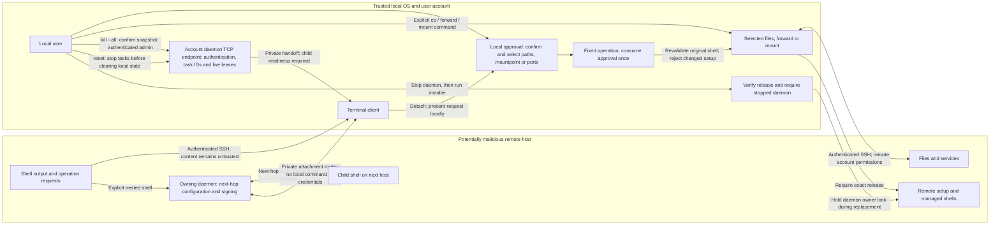

# Security model

sshore separates remote shell interaction from permission to access local files
and services. **An authenticated remote host is not necessarily trustworthy.**
Remote requests are proposals; only an explicit local command or local approval
grants access.

This document describes threats, controls and their limits. Implementation and
lifecycle details belong in [ARCHITECTURE.md](ARCHITECTURE.md); terminology belongs in
[GLOSSARY.md](GLOSSARY.md).

## Scope and assumptions

The model protects local files and services from unapproved remote requests,
approvals from replay or substitution, and managed tasks from accidental takeover
or termination of the wrong process. It also limits what state and diagnostics
expose. It does not promise availability or trustworthy remote computation.

| Actor or component | Assumption |
| --- | --- |
| Local OS, account, terminal, sshore executable and SSH configuration | Trusted. Administrators and processes running as the same local user are inside this boundary. |
| Remote host, daemon and programs in the remote account | Potentially malicious. They may forge requests, metadata, terminal output and responses. |
| Network | Untrusted. Go SSH provides endpoint authentication and transport integrity under the local host-key policy. |
| Release publisher and distribution repository | Trusted to supply the installer, executable and checksums. Checksums alone do not protect against a compromised publisher. |
| Local user | Chooses commands and reviews requested access. Approval is not a malware scan or proof that the remote requester is honest. |

A compromised remote root or kernel can ignore lifecycle rules, lie about files
and process identities, or retain data. Remote-side checks protect against mistakes
and ordinary races on a cooperating host; they cannot compel a hostile host.

## Trust boundaries

Remote output, public names, task IDs and inventory records are not
capabilities. Local control requires private state and authentication. Remote
operations remain constrained by the authenticated account and SSH server policy.

Local attachment handoff is accepted through authenticated local control, never
inferred from terminal output. A nested remote shell is executed by the daemon on
its initiating host, using that host's configuration and signing credentials. The terminal client
receives an attachment route, not an instruction to execute the remote command or
use the root account's credentials for the next hop. Child readiness is required
before the launcher reports success. The authenticated daemon tracks the parent scope.

Routes are private capabilities bound to the parent shell instance. Each route
opens authenticated endpoints to the fixed child instance, using local daemon
connections or native channels on the initiating daemon's SSH session.
Reattachment and short file transfers reuse the attachment route. For approved
mounts and forwards, a live route identifies each trusted initiating daemon and
the exact destination task during startup. Each remote hop opens a fresh SSH
connection using its original initiating host's configuration and credentials.
An expired route or changed parent blocks startup. Remote-supplied aliases never
select destinations in the terminal client's SSH configuration. After startup,
the resource owns its connections and remains available when a source or
ancestor shell exits.

Route messages and terminal output grant no resource approval. Host-key
confirmation and interactive answers use a private authenticated broker on the
initiating host. Nested shell launchers close their broker after handoff. Resource
redials on those hosts require known host keys and noninteractive SSH
authentication. Standard SSH
`ProxyJump` uses the initiating SSH client's usual authentication for its jump
chain. Private keys and interactive answers stay on the initiating host.

Managed shell channels reach the account daemon's loopback TCP endpoint through
SSH TCP forwarding. Every channel authenticates with the account capability before
selecting a task ID. SSH server policy must allow it; sshore does not bypass a refusal.
Preparation and bridge processes are not retained as per-shell trust boundaries.

## Threats and safeguards

| Attack scenario | Primary gate | Remaining risk |
| --- | --- | --- |
| Remote output tricks the user into granting local access | [Local approval](approval.md#local-approval) | A user may still approve a deceptive request. |
| An old request is replayed or redirected to another shell | Single-use records and original-shell checks | A malicious server can lie about its own identity. |
| A file request overwrites a local file or changes after approval | [Selected paths and no-overwrite publication](#files-and-forwarding) | Content can be malicious or change without changing size. |
| A remote program exposes a local service | Locally selected, fixed forwarding endpoints | Loopback is not per-user isolation; server policy can alter reverse binds. |
| Another process takes over or cancels unrelated work | [Private capabilities and process identity checks](#shell-control-and-lifetime) | Same-user compromise and deliberately escaped tasks are outside the guarantee. |
| Setup silently downgrades software or kills tasks before replacement is ready | [Exact versions and stopped-daemon requirement](#remote-setup-and-updates) | Explicit task termination can lose unsaved work. |
| A remote filesystem hangs, floods responses or leaves writes uncertain | [Bounded mount requests and no write replay](#sftp-mounts) | Partial writes, stale data and resource exhaustion remain possible. |
| Forged status records become authority to act | [Advisory inventory only](#inventory-and-privacy) | Displayed status may be false or stale. |

For the approval screens, single-use grants and trusted command console, see
[local approval and the command console](approval.md).

## SSH authentication

Local client configuration is a trusted input. The built-in resolver evaluates
static `Match` conditions without executing configuration hooks. Go SSH owns
the connection and verifies host keys. Changed host keys are rejected.
Background forward retries require existing host trust on every hop and run
without interactive credentials.
Host-key verification reads the current configured user and system known_hosts
files, including quoted paths and multiple drive-qualified paths on Windows.
Configured algorithm lists restrict the Go SSH implementation's supported
algorithms. Host certificate signature restrictions apply during verification.
After interactive confirmation, the client reloads those files before
saving the key, including files created during confirmation.
The SSH client uses configured private keys during the authentication handshake.
The initiating frontend requests passphrases, passwords and keyboard-interactive
answers as needed. These credentials are scoped to the handshake. Ctrl+C at an
authentication prompt aborts the connection attempt and releases terminal input.
The local prompt broker serializes terminal access and bounds request and
response sizes for host confirmation and authentication prompts.

Servers may accept SSH `none` authentication, such as Tailscale SSH; host-key
verification and operation approval still apply. The client skips unsupported
authentication methods and reports failure when SSH authentication exhausts the
available methods. Unsupported execution hooks fail explicitly. Public-key
restrictions and RSA size requirements remain enforced. `RevokedHostKeys` files
are rejected. The client honors known_hosts revocation markers. Connections use
independent transports. Forward retry policy is explicit.

## Files and forwarding

### File substitution, overwrite and malicious content

Direct copies are explicit local grants. Approved downloads expose the selected
source, and approved uploads allow writing only to the private staging file.
Both paths use bounded transfers, temporary files and atomic hard-link
publication without overwriting. Approved file sizes bound received bytes.
Changed metadata is rejected, and uploads verify stored temporary content by
size and SHA-256 readback on the receiving sshore before publication. The sender
appends a 32-byte digest to the transfer. The receiver seals the temporary file,
verifies its contents, and strips the digest before publishing the payload.

Local sources reject final-component symlinks/reparse points and compare opened
file identity with the initial check. Uploads keep the file handle opened during
path selection or batch preflight. Approved downloads keep the remote handle
opened when the transfer validates source metadata. Linux uses nonblocking opens
so a substituted FIFO cannot stall validation. These checks do not lock parent
directories or stop changes to the contents of the same file. Same-size content
changes remain possible.

SSH integrity and readback checks do not authenticate file provenance. Downloaded
content can be malicious; avoid destinations that automatically load scripts or
configuration. Metadata is not copied. Received Linux files default to `0600`;
Windows files inherit the destination directory ACL.

Direct copies also permit explicitly selected stdin/stdout. Stdin can be unbounded
and fill remote storage; stdout cannot retract bytes after failure. Completed files
remain when a batch fails. Cancellation removes temporary files when cleanup can
run, but forced termination can leave `.sshore-*.part` files. Connection loss
cancels connection-owned transfers; it does not undo completed operations.

### Unwanted listeners and local service access

Forwarding fixes direction, listener and destination before execution. Independent
forwards request IPv4 loopback listeners and loopback destinations; occupied ports
fail without substitution. Remote requests need local port selection or acceptance.
Their helper rechecks the original shell version, name, PID and detached state.
No software update runs during forward approval. The origin binds its local
listener before approval is consumed. The resource endpoint binds reverse listeners
after authorization. Each accepted TCP connection uses a smux stream on the
task transport. Intermediate hosts relay the authenticated stream as bytes.
The destination agent dials the fixed loopback port using TCP. OpenSSH
`PermitOpen` applies to SSH channel destinations.
Explicit local forwarding uses an SSH exec service on the destination. Approved
forwarding connects to the original shell's account daemon through a fresh SSH
transport. The authenticated account owns the listeners.

**Limits:** loopback is not per-user isolation. Forwarded services may be malicious.
Local `--retries` explicitly permits bounded reconnection of the same mapping;
it is unavailable to remote requests. Retries require noninteractive authentication
and known host keys, never restore existing application connections, and stop on
cancellation.

Native SSH forwarding (`-L`, `-R`, `-D`), agent forwarding and SSH configuration are
separate local policy, outside remote-request approval. `-R` can expose a local
service to the remote host. Do not bypass host-key checks.

## Shell control and lifetime

**Threat:** a stale name, reused PID or forged status row causes takeover or
termination of unrelated work.

The account daemon and native shell endpoints listen on loopback and require random capabilities
from current-user private state. Unix ownership/permissions and Windows DACLs
protect that state. Exact release checks and lifetime locks prevent silent takeover
or downgrade. Launch environments remain in memory, not public inventory or
persistent daemon records. The selected host’s daemon resolves task IDs against its live registrations. Lease loss releases participation, never another
persistent shell. This is a same-user trust boundary, not a sandbox.

`sh` and `new` reserve a fresh name. `attach` rechecks the selected instance before
admitting a terminal and refuses an unavailable or occupied target. Internal shell
and resource routes require the registered instance. Recent targets supply
connection defaults and carry no typed passwords or takeover authority.

The authenticated starting lease owns the lifetime of a top-level shell.
A same-host nested shell follows the registered parent task. A cross-host
child uses a lease scoped to that parent. Native local shell leases end when
their loopback connections close. SSH shell leases also expire on a missed
heartbeat.

`sh --pin` retains the shell until it exits. Explicit `detach [DURATION]`
sets retention under the same lock as task termination before releasing the
attachment. Internal terminal switches and approval handoffs release an
attachment under the existing scope. When a parent ends, a pinned child
retains its subtree. Independent mounts and forwards retain their own scopes.

Explicit cancellation validates the target instance, capability or process identity;
it never kills a PID solely because a record contains it. Short-ID selection is
bound to the original task instance and cannot authorize control of a replacement.
Aliases are mutable references, not capabilities. Ambiguous short references must
not select an arbitrary task.
Control resolves the immutable task ID in the daemon's memory table. Ending a
task removes its live registration; clients do not infer lifetime from stale files.
Remote shell cancellation uses the same authenticated, exact-release control
entry and targets the registered task. `kill --all` displays a
fresh snapshot and requires explicit confirmation at a `[y/N]` prompt. A change to a reviewed task requires fresh review. For a
remote host, the remote daemon stops first. The local daemon then verifies the
identities and names of all displayed local resources before stopping any of
them.
Other managers' advertisements are excluded. Administrative shutdown and
individual task control both require the exact release.

On Linux the daemon starts each local or hosted shell directly in a dedicated
cgroup v2 child. The daemon retains a kernel handle to `cgroup.kill` for that
registered shell. Explicit stop and shell exit both terminate remaining members
before removing the group. Each managed shell has its own group, independent of
the logical owner tree. Processes running as the same account are trusted and
may have permission to migrate processes out of a group. On macOS, closing the
PTY requests hangup before forced termination of the directly started shell.
Windows closes ConPTY to notify
console applications, then releases the daemon-owned kill-on-close job after
the shell exits or the grace period expires.
No process-name-wide kill is used. A daemon failure can affect all terminals it owns.

Recorded owner contexts and attachment sources are display metadata, not verified
OS ancestry. They never authorize signaling or change the actual owner or lease.

## SFTP mounts

**Threat:** a remote filesystem gains unintended local authority, returns hostile
paths/data, or leaves an application waiting indefinitely on uncertain writes.

A local `mount` command explicitly grants access to a remote directory. Applications
with access to that mount can read and, unless `--read-only` is set, overwrite,
rename or delete files using the remote account's permissions. A remote program
may request a mount through the [local approval gate](approval.md#local-approval), but cannot
approve it or choose the final local mountpoint. Approval displays the access mode;
startup revalidates the original detached shell on the mount's SSH connection.
The resulting mount is independent of that shell. Legacy disabled mode rejects it.

The selected root is a navigation boundary, **not remote-account confinement**.
Remote symlinks can be followed with the account's permissions. Linux readlink
results are restricted to the mounted tree so absolute remote links cannot redirect
local tools into unrelated local files. Windows rejects unrepresentable names
instead of silently aliasing them. Remote filenames, attributes and data remain
untrusted.

Mounts require a matching release. The agent serves SFTP in Go under the
authenticated account. Remote startup requires command execution and a matching
`sshore` on the SSH session's PATH. Windows hosts accept direct mounts.
Approved mounts use the shell account daemon's SFTP agent.
Accounts restricted to `internal-sftp` cannot start the agent.
OpenSSH subsystem flags apply only to the SSH subsystem. The mount connection
disables native forwarding, backgrounding and ControlMaster sharing.

Outstanding SFTP requests have individual deadlines that other responses or
keepalives cannot extend. Timeout aborts the connection; **a write may already have
completed remotely**. No write is replayed. There is no persistent write-back spool,
conflict detection, local-disk locking or atomic multi-operation transaction.
A server response is not proof that a compromised server stored data.

Normal shutdown tries to unmount while the transport is live; a busy mount stays
connected for retry. Forced shutdown may leave partial writes. Close applications
before stopping a mount. Exclusive creation prevents overwriting a new file, but a
failed permissions operation can leave an empty remote file.

Packets, directory responses, caches and watch subscriptions have bounded budgets.
Oversized listings fail rather than silently truncate. Caches and open directory
snapshots can show stale state; notifications are advisory and may be lost.
Local mutations invalidate known paths; hard-link or symlink aliases and paths of
renamed open files may remain stale until background verification, notification
or cache expiry. Background verification is bounded and advisory; it cannot
prove file identity or authorize an operation. Neither
notifications nor status queries authorize file operations or write replay. See
[mount implementation](mount.md) for startup, caches and change notifications.

## Remote setup and updates

**Threat:** installation runs an unintended executable, downgrades software,
or replaces it while the account daemon still owns tasks.

Managed remote commands require the exact full release, including PATCH.
The authenticated SSH exec channel passes a versioned service request before
starting the selected protocol. The request selects a handler and carries no
additional authority. Approved routes and task mutations retain their existing
source, identity and account-daemon checks.
Shell, file and forward services reject a mismatched release before opening a
task or stream. The client deploys a versioned server under the authenticated
account's private directory through SFTP. It uploads to a temporary file and
publishes the complete file by rename. SSH exec selects that path on the same
authenticated connection. Client IDs select separate directories within the
same OS account. Account permissions govern filesystem access.

Remote `kill --all` presents the daemon's live task snapshot before stopping it
and verifies the confirmed snapshot before shutdown. The local installer
verifies the release checksum and executable version, then stages the replacement.
It uses the installed client to review the local daemon and, on a version change,
its recorded remote deployments. Active tasks require confirmation of the
displayed snapshot. A declined or failed shutdown leaves the installed client
in place. Before publishing under the startup and owner locks, the installer
rechecks the target against the file it inspected. Installation preserves local
state. Use `reset` to clear it. Unknown or newer installed releases require
manual handling.

Replacement requires a user-owned regular file and a user-owned directory
without group/world write permission on Linux. Replacement does not elevate
privileges. The Linux installer adds its executable directory to user shell
profiles. See [installation](../README.md#install-the-client) for PATH behavior.

Release checksums detect corruption, not publisher compromise. Cached artifacts are
private and rechecked on reuse; unavailable assets never cause substitution of a
different release.
The publisher retains immutable tags and assets for deployment to new hosts.
See [release mechanics](RELEASE.md).

`reset` uses the authenticated administrative snapshot and shutdown before clearing
local state and cached releases. Failed shutdown stops reset; busy mounts may refuse
cleanup. Custom state roots are cleared by entry name, including when inherited
from the running daemon. Account cleanup removes the daemon locator and log.
It preserves coordination locks to prevent concurrent startup.

## Setup failure

Use ordinary SSH for manual repair. Installer scripts verify the release before
invoking the prepared executable to apply it. Install help is read-only.

## Inventory and privacy

Public inventory is an allowlist: it excludes control addresses/tokens, SSH options
and terminal contents. Shell process listings show sanitized same-user names and
PIDs, excluding arguments and environments. Live tree edges describe registered parent shells or the holder of a live
cross-host owner lease. Tree reservations and private child routes authorize
foreground handoffs and stay outside the public inventory. Foreground summaries and detailed resource
status can reveal working-directory/project names, paths, ports and errors.

Peer records expose only their resource identity, manager label, remote-facing
path or port direction, and state. They exclude local mount paths and unrelated
hosts. A remote account can forge its own inventory. The account daemon displays
incoming resources in `list` for the lifetime of their authenticated
socket leases. When connections overlap, it displays the newest live lease for
each resource key. EOF or a missed heartbeat releases that connection's
registration. These read-only entries establish transport participation.
Resource control requires separate authorization. Attachment-source metadata is advisory.

Cached shell relationships, task IDs and worker liveness
are not proof of identity, successful cleanup or remote service health. Targets
are not probed. `list` reads remote shell observations from the local daemon.
`pstree` uses the last observed shell state and parent to render its branches.
`list` includes the last known parent ID and observation time.
The host resolves task selectors against its live registry. The command prompt
reads the current host’s registered tasks through its authenticated attachment.
The temporary prompt uses the local daemon. The client sanitizes inventory for
terminal display.

See [inventory and diagnostics](ARCHITECTURE.md#inventory-and-diagnostics) for implementation entry points.

## Remaining risks

- Local account/root compromise, terminal-emulator vulnerabilities or deliberate
  user approval of a deceptive request defeats this boundary. Displayed paths and
  errors are sanitized, but raw remote terminal output remains untrusted; terminal
  compatibility filters are not a security boundary.
- Limits bound individual requests and buffers, not all resource consumption.
  Approved large files or stdin streams can fill disks. Repeated requests can disrupt
  work, and a hostile host can delay, disconnect or falsify responses.
- Process visibility can limit cleanup. Deliberately escaped tasks, legacy binaries,
  unmanaged concurrent changes and a hostile remote kernel are outside termination
  guarantees. Diagnostics never authorize termination by themselves.
- SSH authenticates a transport endpoint. It does not authenticate file provenance,
  make a forwarded service safe, or guarantee the remote host's behavior.

Host grouping identities use MD5 solely as compact display metadata, never as authentication or integrity evidence. A new connection entry point for a known identity produces a remembered advisory warning; it does not block SSH or prove cloning.
